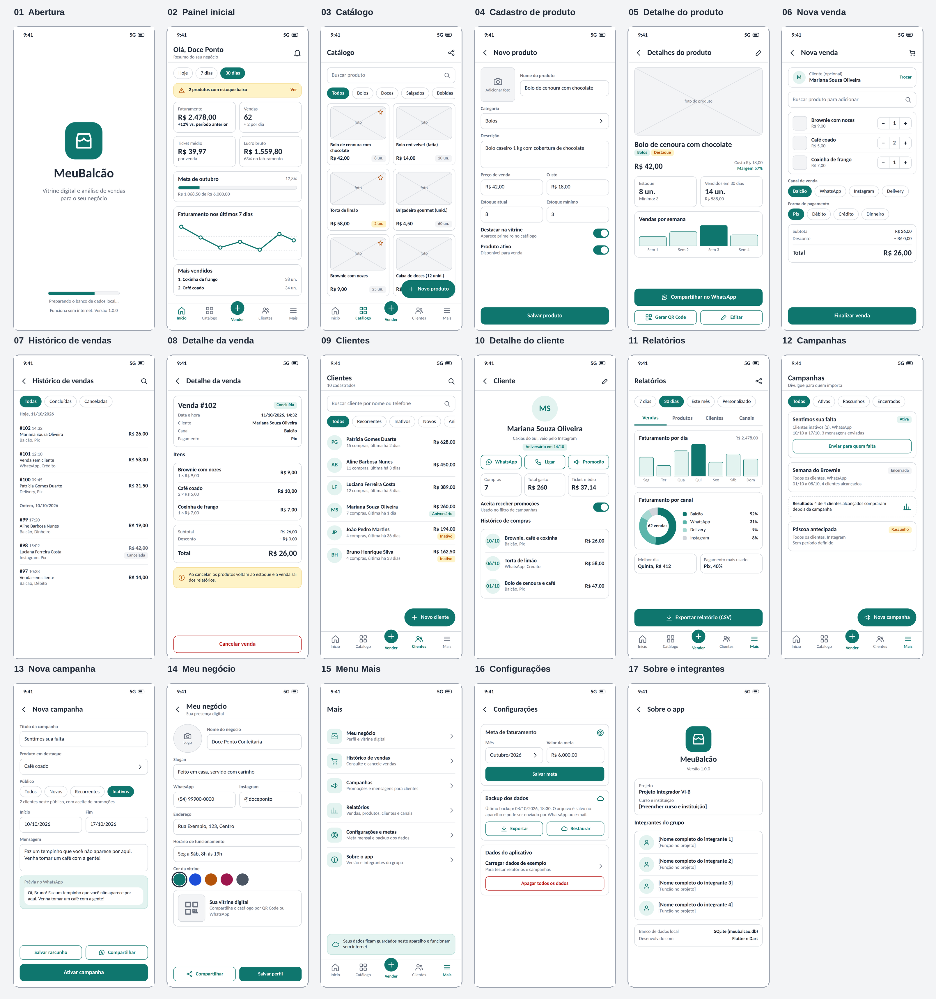

# MeuBalcão

> **Vitrine digital e análise de vendas para pequenos negócios. Funciona sem internet.**

Projeto Integrador VI-B — **Etapa 1: planejamento e documentação**

**Repositório no GitHub:** <https://github.com/Marcus-Monaco/projeto-integrador-2026-2>

---

## Questão norteadora

> *"Qual aplicativo de celular pode auxiliar no crescimento e inovação dos negócios?"*

O **MeuBalcão** é um aplicativo Android que ajuda pequenos empreendedores a **melhorar a presença digital** do negócio (catálogo, vitrine compartilhável, QR Code e campanhas por WhatsApp) e a **tomar decisões com base em dados** (painel de vendas, metas, rankings e relatórios), tudo gravado em um **banco de dados SQLite local**, que funciona mesmo sem conexão com a internet.

## Índice da Etapa 1

| # | Item solicitado | Onde está |
|---|---|---|
| 1 | Nome do projeto | [docs/01-nome-do-projeto.md](docs/01-nome-do-projeto.md) |
| 2 | Problema que resolve | [docs/02-problema-e-solucao.md](docs/02-problema-e-solucao.md) |
| 3 | Público-alvo | [docs/03-publico-alvo.md](docs/03-publico-alvo.md) |
| 4 | Características do aplicativo (funcionalidades) | [docs/04-caracteristicas.md](docs/04-caracteristicas.md) |
| 5 | Modelo ER do banco de dados local | [docs/05-modelo-er.md](docs/05-modelo-er.md) |
| 6 | Wireframe das telas em alta definição | [docs/06-wireframes.md](docs/06-wireframes.md) |
| 7 | Tela com o nome completo dos integrantes | [docs/07-tela-integrantes.md](docs/07-tela-integrantes.md) |
| 8 | Como será gerado o arquivo APK | [docs/08-geracao-apk.md](docs/08-geracao-apk.md) |
| 9 | Tecnologias, bibliotecas e linguagens (com links) | [docs/09-tecnologias.md](docs/09-tecnologias.md) |
| 10 | Banco de dados local e sua implementação | [docs/10-banco-local.md](docs/10-banco-local.md) |

## Integrantes do grupo

| Nome completo | Função no projeto |
|---|---|
| Henrique Bin Estramar                | Gerente de projeto e documentação |
| Lucas Cechett Hofmann                | Modelagem e banco de dados |
| Mauricio Andryell Porgeri dos Santos | Desenvolvimento do aplicativo (Flutter) |
| Marcus Vinicius Sena Pereira         | Design de interface, testes e entrega do APK |

**Análise e Desenvolvimento de Sistemas / Universidade de Caxias do Sul** 

## Resumo técnico

| Item | Escolha |
|---|---|
| Plataforma | Android (arquivo `.apk`) |
| Framework / linguagem | Flutter / Dart |
| Banco de dados local | SQLite, por meio do pacote `sqflite` (arquivo `meubalcao.db` no aparelho) |
| Modelo de dados | 9 tabelas, 7 relacionamentos, restrições PK, FK, UNIQUE, CHECK e DEFAULT |
| Telas | 17 wireframes em alta definição (1170 × 2532 px) |

## Estrutura do repositório

```text
projeto-integrador-2026-2/
├── README.md                  ← este arquivo (índice da Etapa 1)
├── .gitignore
├── docs/                      ← documentação em Markdown (itens 1 a 10)
│   ├── 01-nome-do-projeto.md
│   ├── 02-problema-e-solucao.md
│   ├── 03-publico-alvo.md
│   ├── 04-caracteristicas.md
│   ├── 05-modelo-er.md
│   ├── 06-wireframes.md
│   ├── 07-tela-integrantes.md
│   ├── 08-geracao-apk.md
│   ├── 09-tecnologias.md
│   └── 10-banco-local.md
├── database/                  ← banco de dados local (SQLite)
│   ├── schema.sql             ← criação das tabelas, restrições e índices
│   ├── seed.sql               ← dados de exemplo (fictícios)
│   └── consultas.sql          ← consultas dos relatórios e do painel
└── assets/
    ├── er/                    ← diagrama ER (PNG e SVG)
    └── wireframes/            ← 17 telas em PNG + visão geral
        └── html/              ← código-fonte (HTML/CSS) dos wireframes
```

## Como conferir o banco de dados

Com o SQLite instalado, é possível recriar e testar todo o modelo em um computador:

```bash
sqlite3 meubalcao.db < database/schema.sql
sqlite3 meubalcao.db < database/seed.sql
sqlite3 meubalcao.db < database/consultas.sql
```

## Visão geral das telas

[](docs/06-wireframes.md)

---

*Os dados de exemplo (negócio "Doce Ponto Confeitaria", clientes e vendas) são fictícios e servem apenas para demonstração e testes.*
