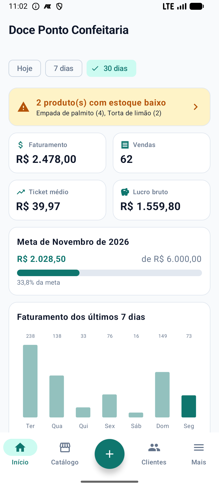

# MeuBalcão

> **Vitrine digital e análise de vendas para pequenos negócios. Funciona sem internet.**

Projeto Integrador VI-B: **Etapa 1 (planejamento e documentação)** e **Etapa 2 (implementação do aplicativo)**

**Repositório no GitHub:** <https://github.com/Marcus-Monaco/projeto-integrador-2026-2>

## Entregas da Etapa 2

| Entrega | Onde está |
|---|---|
| 📱 **APK do aplicativo** | [`apk/MeuBalcao-1.0.0.apk`](apk/MeuBalcao-1.0.0.apk) (Android 8.0 ou superior, cerca de 1,4 MB) |
| 💻 **Código-fonte** | [`app/`](app/) (Kotlin + Jetpack Compose), com build pelo Gradle Wrapper na raiz |
| 🗄️ **Como o banco de dados local é construído** | [docs/10-banco-local.md](docs/10-banco-local.md) |
| 🎬 **Vídeo demonstrativo (YouTube, não listado)** | [docs/12-video-demonstrativo.md](docs/12-video-demonstrativo.md) |
| 📄 **Documentação revisada** | Índice abaixo (capítulos 1 a 12) |

## Questão norteadora

> *"Qual aplicativo de celular pode auxiliar no crescimento e inovação dos negócios?"*

O **MeuBalcão** é um aplicativo Android que ajuda pequenos empreendedores a **melhorar a presença digital** do negócio (catálogo, vitrine compartilhável, QR Code e campanhas por WhatsApp) e a **tomar decisões com base em dados** (painel de vendas, metas, rankings e relatórios). Tudo fica gravado em um **banco de dados SQLite local**, que funciona mesmo sem conexão com a internet.

| Painel | Nova venda | Relatórios | Sobre e integrantes |
|---|---|---|---|
|  |  |  |  |

## Índice da documentação

| # | Item | Onde está |
|---|---|---|
| 1 | Nome do projeto | [docs/01-nome-do-projeto.md](docs/01-nome-do-projeto.md) |
| 2 | Problema que resolve | [docs/02-problema-e-solucao.md](docs/02-problema-e-solucao.md) |
| 3 | Público-alvo | [docs/03-publico-alvo.md](docs/03-publico-alvo.md) |
| 4 | Características do aplicativo (funcionalidades) | [docs/04-caracteristicas.md](docs/04-caracteristicas.md) |
| 5 | Modelo ER do banco de dados local | [docs/05-modelo-er.md](docs/05-modelo-er.md) |
| 6 | Wireframe das telas em alta definição | [docs/06-wireframes.md](docs/06-wireframes.md) |
| 7 | Tela com o nome completo dos integrantes | [docs/07-tela-integrantes.md](docs/07-tela-integrantes.md) |
| 8 | Como o arquivo APK é gerado | [docs/08-geracao-apk.md](docs/08-geracao-apk.md) |
| 9 | Tecnologias, bibliotecas e linguagens (com links) | [docs/09-tecnologias.md](docs/09-tecnologias.md) |
| 10 | Banco de dados local: construção e implementação | [docs/10-banco-local.md](docs/10-banco-local.md) |
| 11 | Implementação do aplicativo (Etapa 2) | [docs/11-implementacao.md](docs/11-implementacao.md) |
| 12 | Vídeo demonstrativo | [docs/12-video-demonstrativo.md](docs/12-video-demonstrativo.md) |

## Integrantes do grupo

| Nome completo | Função no projeto |
|---|---|
| Henrique Bin Estramar                | Gerente de projeto e documentação |
| Lucas Cechett Hofmann                | Modelagem e banco de dados |
| Mauricio Andryell Porgeri dos Santos | Desenvolvimento do aplicativo (Kotlin) |
| Marcus Vinicius Sena Pereira         | Design de interface, testes e entrega do APK |

**Análise e Desenvolvimento de Sistemas / Universidade de Caxias do Sul**

## Resumo técnico

| Item | Escolha |
|---|---|
| Plataforma | Android 8.0 (API 26) ou superior, arquivo `.apk` |
| Linguagem / interface | Kotlin + Jetpack Compose (Material 3) |
| Banco de dados local | SQLite nativo do Android (`SQLiteOpenHelper`), arquivo `meubalcao.db` no aparelho |
| Modelo de dados | 9 tabelas, 7 relacionamentos, restrições PK, FK, UNIQUE, CHECK e DEFAULT |
| Telas | 17 telas dos wireframes, todas implementadas |
| Requisitos | 28 requisitos funcionais implementados |
| Testes | 18 testes automatizados (banco e regras de negócio), todos passando |
| Build | Gradle Wrapper 8.14.3, Android Gradle Plugin 8.12, Kotlin 2.1.20 |

> A Etapa 1 previa Flutter. Na implementação, o grupo usou Kotlin nativo, mantendo o mesmo banco, as mesmas telas e os mesmos requisitos. As diferenças estão em [docs/11-implementacao.md](docs/11-implementacao.md#116-diferenças-em-relação-ao-planejamento-da-etapa-1).

## Como executar

**Jeito mais rápido: script automático.** No Windows, use o **Git Bash**; no Linux e no macOS, o terminal. Na pasta do repositório:

```bash
bash configurar-e-rodar.sh
```

O script [`configurar-e-rodar.sh`](configurar-e-rodar.sh) faz tudo sozinho:

1. Confere o Java. Se não houver JDK 17+, baixa o JDK 21 para `~/.meubalcao`.
2. Encontra o Android SDK ou instala o mínimo necessário.
3. Cria o `local.properties`, roda os testes e compila.
4. Abre um emulador (cria um se não existir), instala e abre o MeuBalcão.

Opções: `--sem-testes` (mais rápido) e `--apk` (só gera o APK de release, sem emulador).

**Opção 1: instalar o APK.** Baixe [`apk/MeuBalcao-1.0.0.apk`](apk/MeuBalcao-1.0.0.apk) no celular (ou arraste para o emulador) e permita a instalação de fontes desconhecidas.

**Opção 2: a partir do código-fonte**, com o [Android Studio](https://developer.android.com/studio) instalado:

```bash
git clone https://github.com/Marcus-Monaco/projeto-integrador-2026-2.git
```

1. Abrir a pasta no Android Studio (*File → Open*) e aguardar a sincronização do Gradle.
2. Iniciar um emulador no *Device Manager* e clicar em **▶ Run 'app'**.
3. No painel, tocar em **Carregar dados de exemplo**.

Pela linha de comando (Windows: `gradlew.bat`; Linux/macOS: `./gradlew`):

```bash
gradlew testDebugUnitTest   # roda os 18 testes
gradlew assembleRelease     # gera app/build/outputs/apk/release/app-release.apk
```

## Estrutura do repositório

```text
projeto-integrador-2026-2/
├── README.md                  ← este arquivo
├── configurar-e-rodar.sh      ← configura o PC e abre o app no emulador
├── apk/                       ← APK pronto para instalar
├── app/                       ← código-fonte do aplicativo (Kotlin)
│   ├── build.gradle.kts
│   └── src/
│       ├── main/java/com/meubalcao/app/
│       │   ├── data/          ← banco (AppDatabase), modelos e repositórios
│       │   ├── ui/            ← telas, componentes, navegação e tema
│       │   └── util/          ← formatação, WhatsApp, QR Code, vitrine e CSV
│       └── test/              ← testes automatizados do banco
├── database/                  ← banco de dados local (SQLite), empacotado no APK
│   ├── schema.sql             ← criação das tabelas, restrições e índices
│   ├── seed.sql               ← dados de exemplo (fictícios)
│   └── consultas.sql          ← consultas dos relatórios e do painel
├── docs/                      ← documentação (capítulos 1 a 12)
├── assets/
│   ├── er/                    ← diagrama ER (PNG e SVG)
│   ├── screenshots/           ← capturas do app funcionando
│   └── wireframes/            ← 17 telas planejadas em PNG + código HTML/CSS
├── gradle/, gradlew, gradlew.bat   ← Gradle Wrapper
└── settings.gradle.kts, build.gradle.kts, gradle.properties
```

## Conferir o banco de dados no computador

Com o [SQLite](https://www.sqlite.org/download.html) instalado, é possível recriar e testar todo o modelo:

```bash
sqlite3 meubalcao.db < database/schema.sql
sqlite3 meubalcao.db < database/seed.sql
sqlite3 meubalcao.db < database/consultas.sql
```

Também é possível abrir no [DB Browser for SQLite](https://sqlitebrowser.org) um backup exportado pelo próprio app (**Mais → Configurações → Exportar backup**).

---

*Os dados de exemplo (negócio "Doce Ponto Confeitaria", clientes e vendas) são fictícios e servem apenas para demonstração e testes.*
