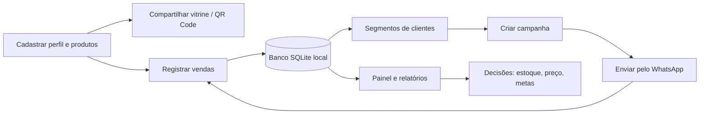

# 4. Características do aplicativo

O MeuBalcão está organizado em **6 módulos** que se integram pelo mesmo banco de dados local. Os números das telas (T01 a T17) referem-se aos [wireframes](06-wireframes.md) e os nomes das tabelas ao [modelo ER](05-modelo-er.md).

**Prioridade:** **E** = essencial (faz parte da primeira versão) · **I** = importante · **D** = desejável (se houver tempo)

## 4.1 Requisitos funcionais

### Módulo 1: Presença digital (vitrine)

| ID | Funcionalidade | Prior. | Telas | Tabelas |
|---|---|---|---|---|
| RF01 | Cadastrar e editar o **perfil do negócio**: nome, slogan, descrição, WhatsApp, Instagram, endereço, horário, logo e cor da vitrine | E | T14 | `perfil_negocio` |
| RF02 | Gerar a **vitrine digital** (cartão visual com o catálogo e os destaques) para compartilhar como imagem pelo WhatsApp e Instagram | E | T14, T03 | `perfil_negocio`, `produto`, `categoria` |
| RF03 | Gerar **QR Code** do negócio/catálogo para exibir no balcão e em feiras | I | T05, T14 | `perfil_negocio` |
| RF04 | **Compartilhar um produto** (foto, nome, preço e descrição) diretamente pelo WhatsApp | E | T05 | `produto` |

### Módulo 2: Catálogo e estoque

| ID | Funcionalidade | Prior. | Telas | Tabelas |
|---|---|---|---|---|
| RF05 | Criar, editar e desativar **categorias** | E | T04, T03 | `categoria` |
| RF06 | Criar, editar, consultar e desativar **produtos**, com foto, preço, custo e estoque | E | T03, T04, T05 | `produto` |
| RF07 | **Buscar** produtos por nome e **filtrar** por categoria | E | T03 | `produto`, `categoria` |
| RF08 | Marcar produtos como **destaque** da vitrine | I | T04, T03 | `produto` |
| RF09 | Exibir **alerta de estoque baixo** quando `estoque_atual <= estoque_minimo` | E | T02, T03 | `produto` |

### Módulo 3: Vendas

| ID | Funcionalidade | Prior. | Telas | Tabelas |
|---|---|---|---|---|
| RF10 | **Registrar venda** com itens, cliente (opcional), canal, forma de pagamento e desconto, com **baixa automática do estoque** | E | T06 | `venda`, `item_venda`, `produto`, `cliente` |
| RF11 | **Cancelar venda**, devolvendo os itens ao estoque e retirando-a dos relatórios | E | T08 | `venda`, `item_venda`, `produto` |
| RF12 | Consultar o **histórico de vendas** com filtro por situação (todas, concluídas, canceladas) | E | T07, T08, T10 | `venda`, `item_venda` |

### Módulo 4: Clientes (mini-CRM)

| ID | Funcionalidade | Prior. | Telas | Tabelas |
|---|---|---|---|---|
| RF13 | Criar, editar e consultar **clientes** (nome, telefone, e-mail, nascimento, cidade, origem e aceite de promoções) | E | T09, T10 | `cliente` |
| RF14 | **Segmentar clientes automaticamente**: recorrentes, inativos, novos e aniversariantes | E | T09, T13 | `cliente`, `venda` |
| RF15 | Ver o **histórico de compras** de cada cliente, com total gasto e ticket médio | E | T10 | `cliente`, `venda` |
| RF16 | **Contato rápido** com o cliente por WhatsApp ou ligação | I | T10 | `cliente` |

### Módulo 5: Campanhas

| ID | Funcionalidade | Prior. | Telas | Tabelas |
|---|---|---|---|---|
| RF17 | Criar **campanhas** com título, mensagem, produto em destaque, período e canal, com modelos de mensagem prontos | E | T12, T13 | `campanha`, `produto` |
| RF18 | Escolher o **público da campanha** por segmento, considerando apenas clientes que aceitaram promoções | E | T13 | `campanha`, `cliente` |
| RF19 | **Enviar pelo WhatsApp** a mensagem personalizada com o nome do cliente, registrando o envio | E | T10, T12, T13 | `envio_campanha` |
| RF20 | **Medir o resultado** da campanha: clientes alcançados e quantos compraram depois | I | T12 | `envio_campanha`, `venda` |

### Módulo 6: Análise de dados e sistema

| ID | Funcionalidade | Prior. | Telas | Tabelas |
|---|---|---|---|---|
| RF21 | **Painel** com faturamento, número de vendas, ticket médio e lucro bruto por período (hoje, 7 dias, 30 dias) | E | T02 | `venda`, `item_venda` |
| RF22 | Definir a **meta de faturamento mensal** e acompanhar o progresso | I | T02, T16 | `meta_mensal`, `venda` |
| RF23 | **Gráficos** de faturamento por dia e por canal de venda | E | T02, T11 | `venda` |
| RF24 | **Rankings** de produtos mais vendidos e de melhores clientes | E | T02, T11 | `item_venda`, `produto`, `cliente` |
| RF25 | **Exportar relatórios em CSV** para abrir em planilhas | I | T11 | `venda`, `item_venda` |
| RF26 | Fazer **backup** do banco de dados e **restaurá-lo** a partir de um arquivo | E | T16 | arquivo `meubalcao.db` |
| RF27 | **Carregar dados de exemplo** para demonstração e **apagar todos os dados** | D | T16 | todas |
| RF28 | Exibir a tela **Sobre o app** com a versão e o **nome completo de todos os integrantes** do grupo | E | T17, T15 | não usa o banco (dados fixos no código) |

> **Resumo:** 28 requisitos funcionais, sendo 21 essenciais, 6 importantes e 1 desejável.

## 4.2 Regras de negócio

| ID | Regra |
|---|---|
| RN01 | O estoque de um produto nunca pode ficar negativo. Uma venda acima do estoque é recusada e nada é gravado. |
| RN02 | Ao registrar uma venda, o preço e o custo do produto são copiados para o item (`preco_unitario`, `custo_unitario`), preservando o histórico caso o preço mude depois. |
| RN03 | `valor_total` da venda = soma dos subtotais dos itens − desconto. O desconto não pode ser maior que a soma dos itens. |
| RN04 | Toda venda deve ter pelo menos um item. O cliente é opcional. |
| RN05 | Vendas canceladas devolvem os itens ao estoque e **não entram** nos relatórios, no painel nem nos segmentos de clientes. |
| RN06 | Produtos e categorias que já têm histórico não são excluídos, apenas desativados. |
| RN07 | Lucro bruto = valor total das vendas concluídas − custo dos itens vendidos. |
| RN08 | **Cliente recorrente:** 3 ou mais compras concluídas. **Cliente inativo:** última compra há mais de 30 dias. **Cliente novo:** cadastrado nos últimos 30 dias. **Aniversariante:** nascimento no mês atual. |
| RN09 | Campanhas só alcançam clientes com `aceita_promocoes = 1`. |
| RN10 | Existe um único perfil de negócio e uma única meta por mês. |
| RN11 | O telefone do cliente não pode se repetir. |

## 4.3 Requisitos não funcionais

| ID | Categoria | Requisito |
|---|---|---|
| RNF01 | **Funcionamento offline** | Todas as funções, exceto o envio final da mensagem pelo WhatsApp, funcionam sem internet, usando o banco SQLite local. |
| RNF02 | Persistência | Os dados permanecem salvos ao fechar o app ou reiniciar o aparelho. |
| RNF03 | Desempenho | Abertura do painel em até 2 segundos com 5 mil vendas cadastradas, em aparelho de entrada. |
| RNF04 | Usabilidade | Textos em português, botões com área de toque mínima de 48 dp, contraste adequado e fluxo de venda em até 4 telas. |
| RNF05 | Compatibilidade | Android 8.0 (API 26) ou superior e telas de 5" a 7". |
| RNF06 | Privacidade | Dados mantidos apenas no aparelho, em armazenamento privado do app. Nenhum dado é enviado automaticamente para servidores. |
| RNF07 | Integridade | Operações que alteram mais de uma tabela (venda, cancelamento) usam **transações**: ou tudo é gravado, ou nada. |
| RNF08 | Manutenibilidade | Código organizado em camadas (interface, estado, repositórios e acesso ao banco) e controle de versão do esquema do banco para futuras migrações. |
| RNF09 | Tamanho | APK de distribuição abaixo de 30 MB. |

## 4.4 Fluxo principal de uso

O ciclo se retroalimenta: **vender gera dados**, os dados mostram **quem e o que** priorizar, a campanha traz o cliente de volta e uma nova venda é registrada.

## 4.5 Escopo

**Dentro do escopo (versão 1.0):** aplicativo Android com banco local, módulos descritos acima, backup manual e exportação CSV.

**Fora do escopo (evoluções futuras):** sincronização em nuvem, vários usuários, pagamento online, emissão de nota fiscal, versão para iOS e envio automático e em massa de mensagens.
