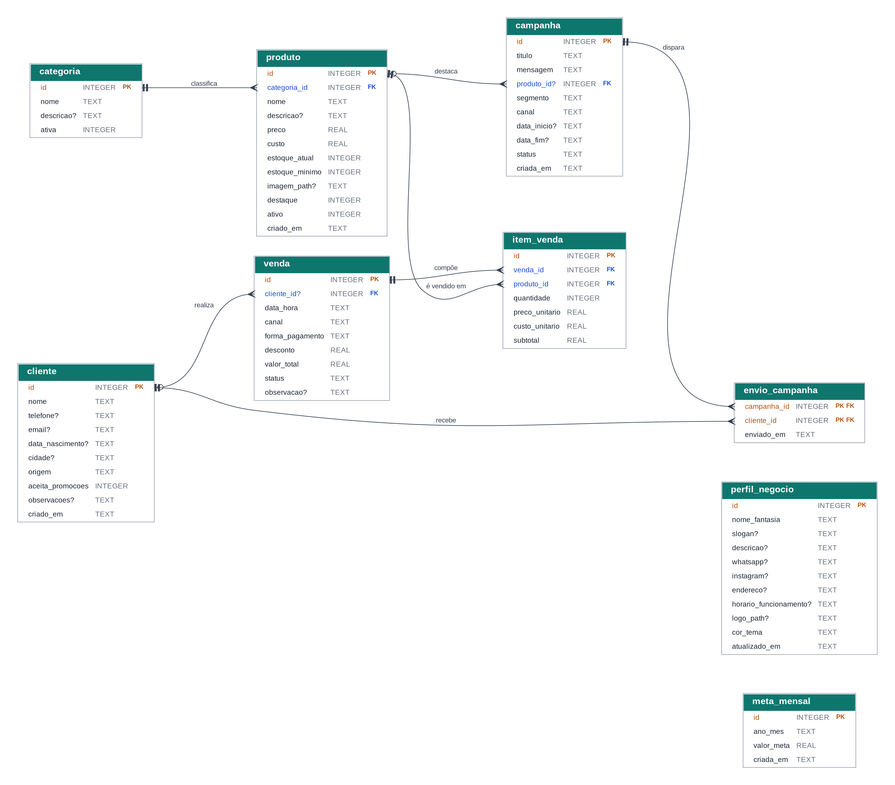
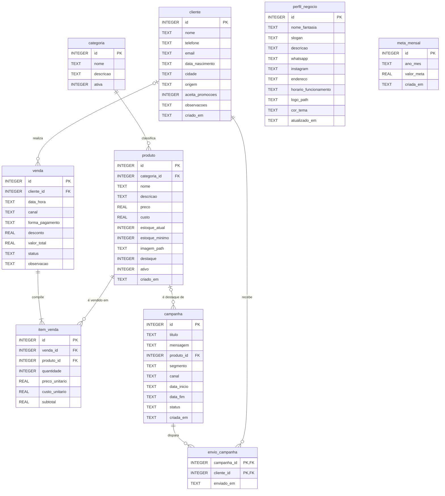

# 5. Modelo ER do banco de dados local

> Banco: **SQLite** (arquivo `meubalcao.db`, guardado no próprio celular). O script completo de criação está em [`database/schema.sql`](../database/schema.sql), os dados de exemplo em [`database/seed.sql`](../database/seed.sql) e as consultas dos relatórios em [`database/consultas.sql`](../database/consultas.sql).

## 5.1 Verificação dos requisitos da etapa

| Requisito | Exigido | Atendido pelo modelo |
|---|---|---|
| Quantidade de tabelas | mínimo 4 | **9 tabelas** |
| Colunas por tabela | mínimo 3 | de 3 (`envio_campanha`) a 12 (`produto`) colunas |
| Relacionamento entre tabelas | ao menos 2 tabelas relacionadas | **7 relacionamentos** por chave estrangeira (2 deles formam relações N:M) |
| Tabelas, colunas e tipos de dados | citados | seção 5.4 (dicionário de dados) |
| Restrições | citadas | PK, FK, NOT NULL, UNIQUE, CHECK e DEFAULT (seções 5.4 e 5.5) |

## 5.2 Diagrama entidade-relacionamento



*Arquivos do diagrama: [PNG em alta resolução](../assets/er/modelo-er.png) e [SVG vetorial](../assets/er/modelo-er.svg).*

**Como ler:** a cor laranja marca a chave primária (**PK**) e a azul a chave estrangeira (**FK**). Um `?` depois do nome da coluna indica que ela aceita valor nulo. O símbolo `||` representa "exatamente um", o pé de galinha representa "muitos" e `|o` representa "zero ou um" (relacionamento opcional).

O mesmo modelo no formato Mermaid (a plataforma do GitHub renderiza o diagrama abaixo automaticamente):



## 5.3 Visão geral das tabelas

| Tabela | Finalidade | Módulo do app |
|---|---|---|
| `perfil_negocio` | Dados do negócio usados na vitrine digital. Existe sempre uma única linha (id = 1). | Presença digital |
| `categoria` | Agrupa os produtos do catálogo (ex.: Bolos, Doces, Bebidas). | Catálogo |
| `produto` | Itens vendidos pelo negócio (produtos ou serviços). | Catálogo |
| `cliente` | Clientes cadastrados (base do mini-CRM e das campanhas). | Clientes |
| `venda` | Cabeçalho de cada venda registrada. | Vendas |
| `item_venda` | Produtos de cada venda (tabela associativa entre venda e produto). | Vendas |
| `campanha` | Campanhas promocionais criadas para divulgar produtos aos clientes. | Campanhas |
| `envio_campanha` | Registra a quem cada campanha foi enviada (tabela associativa entre campanha e cliente). | Campanhas |
| `meta_mensal` | Meta de faturamento definida para cada mês. | Análise de dados |

## 5.4 Dicionário de dados

Tipos físicos do SQLite: `INTEGER`, `TEXT` e `REAL`. O SQLite não possui tipos próprios para data e valores lógicos, por isso datas são gravadas como `TEXT` no padrão ISO-8601 (`AAAA-MM-DD HH:MM:SS`, que ordena corretamente) e valores lógicos como `INTEGER` com `0` ou `1`.

### `perfil_negocio`

Dados do negócio usados na vitrine digital. Existe sempre uma única linha (id = 1).

| Coluna | Tipo (SQLite) | Tipo lógico | Restrições | Descrição |
|---|---|---|---|---|
| `id` | INTEGER | Inteiro | PK, CHECK (id = 1) | Identificador fixo: garante um único perfil por aparelho |
| `nome_fantasia` | TEXT | Texto | NOT NULL | Nome do negócio exibido na vitrine |
| `slogan` | TEXT | Texto | — | Frase curta de apresentação |
| `descricao` | TEXT | Texto | — | Apresentação do negócio |
| `whatsapp` | TEXT | Texto | — | Número com DDD, usado nos links de contato (wa.me) |
| `instagram` | TEXT | Texto | — | Usuário do Instagram |
| `endereco` | TEXT | Texto | — | Endereço do estabelecimento |
| `horario_funcionamento` | TEXT | Texto | — | Dias e horários de atendimento |
| `logo_path` | TEXT | Texto | — | Caminho da imagem do logo no armazenamento do app |
| `cor_tema` | TEXT | Texto (hexadecimal) | NOT NULL, DEFAULT '#0F766E' | Cor principal da vitrine |
| `atualizado_em` | TEXT | Data e hora | NOT NULL, DEFAULT agora | Última alteração do perfil |

### `categoria`

Agrupa os produtos do catálogo (ex.: Bolos, Doces, Bebidas).

| Coluna | Tipo (SQLite) | Tipo lógico | Restrições | Descrição |
|---|---|---|---|---|
| `id` | INTEGER | Inteiro | PK, AUTOINCREMENT | Identificador da categoria |
| `nome` | TEXT | Texto | NOT NULL, UNIQUE (sem diferenciar maiúsculas) | Nome da categoria |
| `descricao` | TEXT | Texto | — | Detalhes da categoria |
| `ativa` | INTEGER | Lógico (0/1) | NOT NULL, DEFAULT 1, CHECK (0 ou 1) | Categoria visível no catálogo |

### `produto`

Itens vendidos pelo negócio (produtos ou serviços).

| Coluna | Tipo (SQLite) | Tipo lógico | Restrições | Descrição |
|---|---|---|---|---|
| `id` | INTEGER | Inteiro | PK, AUTOINCREMENT | Identificador do produto |
| `categoria_id` | INTEGER | Inteiro | FK → categoria.id, NOT NULL | Categoria do produto |
| `nome` | TEXT | Texto | NOT NULL, UNIQUE com categoria_id | Nome do produto |
| `descricao` | TEXT | Texto | — | Descrição exibida na vitrine |
| `preco` | REAL | Decimal | NOT NULL, CHECK (preco >= 0) | Preço de venda (R$) |
| `custo` | REAL | Decimal | NOT NULL, DEFAULT 0, CHECK (custo >= 0) | Custo unitário (R$), base do lucro bruto |
| `estoque_atual` | INTEGER | Inteiro | NOT NULL, DEFAULT 0, CHECK (>= 0) | Unidades em estoque (nunca negativo) |
| `estoque_minimo` | INTEGER | Inteiro | NOT NULL, DEFAULT 0, CHECK (>= 0) | Nível que dispara o alerta de estoque baixo |
| `imagem_path` | TEXT | Texto | — | Caminho da foto do produto no armazenamento do app |
| `destaque` | INTEGER | Lógico (0/1) | NOT NULL, DEFAULT 0, CHECK (0 ou 1) | Produto em destaque na vitrine |
| `ativo` | INTEGER | Lógico (0/1) | NOT NULL, DEFAULT 1, CHECK (0 ou 1) | Disponível para venda |
| `criado_em` | TEXT | Data e hora | NOT NULL, DEFAULT agora | Data do cadastro |

### `cliente`

Clientes cadastrados (base do mini-CRM e das campanhas).

| Coluna | Tipo (SQLite) | Tipo lógico | Restrições | Descrição |
|---|---|---|---|---|
| `id` | INTEGER | Inteiro | PK, AUTOINCREMENT | Identificador do cliente |
| `nome` | TEXT | Texto | NOT NULL | Nome completo |
| `telefone` | TEXT | Texto | UNIQUE | Telefone/WhatsApp com DDD (evita cadastro duplicado) |
| `email` | TEXT | Texto | — | E-mail do cliente |
| `data_nascimento` | TEXT | Data | — | Usada para o segmento de aniversariantes |
| `cidade` | TEXT | Texto | — | Cidade do cliente |
| `origem` | TEXT | Texto | NOT NULL, DEFAULT BALCAO, CHECK (BALCAO, WHATSAPP, INSTAGRAM, INDICACAO, OUTRO) | Como o cliente conheceu o negócio |
| `aceita_promocoes` | INTEGER | Lógico (0/1) | NOT NULL, DEFAULT 1, CHECK (0 ou 1) | Consentimento para receber campanhas |
| `observacoes` | TEXT | Texto | — | Anotações livres |
| `criado_em` | TEXT | Data e hora | NOT NULL, DEFAULT agora | Data do cadastro |

### `venda`

Cabeçalho de cada venda registrada.

| Coluna | Tipo (SQLite) | Tipo lógico | Restrições | Descrição |
|---|---|---|---|---|
| `id` | INTEGER | Inteiro | PK, AUTOINCREMENT | Número da venda |
| `cliente_id` | INTEGER | Inteiro | FK → cliente.id, NULL permitido | Cliente da venda (opcional) |
| `data_hora` | TEXT | Data e hora | NOT NULL, DEFAULT agora | Momento da venda |
| `canal` | TEXT | Texto | NOT NULL, DEFAULT BALCAO, CHECK (BALCAO, WHATSAPP, INSTAGRAM, DELIVERY, OUTRO) | Canal pelo qual a venda aconteceu |
| `forma_pagamento` | TEXT | Texto | NOT NULL, DEFAULT PIX, CHECK (DINHEIRO, PIX, CARTAO_DEBITO, CARTAO_CREDITO, OUTRO) | Forma de pagamento |
| `desconto` | REAL | Decimal | NOT NULL, DEFAULT 0, CHECK (>= 0) | Desconto total aplicado (R$) |
| `valor_total` | REAL | Decimal | NOT NULL, CHECK (>= 0) | Soma dos itens menos o desconto (R$) |
| `status` | TEXT | Texto | NOT NULL, DEFAULT CONCLUIDA, CHECK (CONCLUIDA, CANCELADA) | Vendas canceladas não entram nos relatórios |
| `observacao` | TEXT | Texto | — | Anotação da venda |

### `item_venda`

Produtos de cada venda (tabela associativa entre venda e produto).

| Coluna | Tipo (SQLite) | Tipo lógico | Restrições | Descrição |
|---|---|---|---|---|
| `id` | INTEGER | Inteiro | PK, AUTOINCREMENT | Identificador do item |
| `venda_id` | INTEGER | Inteiro | FK → venda.id, NOT NULL | Venda a que o item pertence |
| `produto_id` | INTEGER | Inteiro | FK → produto.id, NOT NULL, UNIQUE com venda_id | Produto vendido |
| `quantidade` | INTEGER | Inteiro | NOT NULL, CHECK (quantidade > 0) | Unidades vendidas |
| `preco_unitario` | REAL | Decimal | NOT NULL, CHECK (>= 0) | Preço do produto no momento da venda (histórico preservado) |
| `custo_unitario` | REAL | Decimal | NOT NULL, DEFAULT 0, CHECK (>= 0) | Custo do produto no momento da venda (base do lucro) |
| `subtotal` | REAL | Decimal | NOT NULL, CHECK (>= 0) | quantidade × preco_unitario |

### `campanha`

Campanhas promocionais criadas para divulgar produtos aos clientes.

| Coluna | Tipo (SQLite) | Tipo lógico | Restrições | Descrição |
|---|---|---|---|---|
| `id` | INTEGER | Inteiro | PK, AUTOINCREMENT | Identificador da campanha |
| `titulo` | TEXT | Texto | NOT NULL | Título interno da campanha |
| `mensagem` | TEXT | Texto | NOT NULL | Texto enviado aos clientes |
| `produto_id` | INTEGER | Inteiro | FK → produto.id, NULL permitido | Produto em destaque (opcional) |
| `segmento` | TEXT | Texto | NOT NULL, DEFAULT TODOS, CHECK (TODOS, NOVOS, RECORRENTES, INATIVOS, ANIVERSARIANTES) | Público-alvo da campanha |
| `canal` | TEXT | Texto | NOT NULL, DEFAULT WHATSAPP, CHECK (WHATSAPP, INSTAGRAM, OUTRO) | Canal de divulgação |
| `data_inicio` | TEXT | Data | — | Início da campanha |
| `data_fim` | TEXT | Data | CHECK (data_fim >= data_inicio) | Fim da campanha |
| `status` | TEXT | Texto | NOT NULL, DEFAULT RASCUNHO, CHECK (RASCUNHO, ATIVA, ENCERRADA) | Situação da campanha |
| `criada_em` | TEXT | Data e hora | NOT NULL, DEFAULT agora | Data de criação |

### `envio_campanha`

Registra a quem cada campanha foi enviada (tabela associativa entre campanha e cliente).

| Coluna | Tipo (SQLite) | Tipo lógico | Restrições | Descrição |
|---|---|---|---|---|
| `campanha_id` | INTEGER | Inteiro | PK composta, FK → campanha.id | Campanha enviada |
| `cliente_id` | INTEGER | Inteiro | PK composta, FK → cliente.id | Cliente que recebeu |
| `enviado_em` | TEXT | Data e hora | NOT NULL, DEFAULT agora | Momento do envio (base para medir resultado) |

### `meta_mensal`

Meta de faturamento definida para cada mês.

| Coluna | Tipo (SQLite) | Tipo lógico | Restrições | Descrição |
|---|---|---|---|---|
| `id` | INTEGER | Inteiro | PK, AUTOINCREMENT | Identificador da meta |
| `ano_mes` | TEXT | Texto (AAAA-MM) | NOT NULL, UNIQUE, CHECK (formato AAAA-MM) | Mês da meta (uma meta por mês) |
| `valor_meta` | REAL | Decimal | NOT NULL, CHECK (valor_meta > 0) | Valor da meta (R$) |
| `criada_em` | TEXT | Data e hora | NOT NULL, DEFAULT agora | Data de criação |

## 5.5 Relacionamentos e regras de integridade

| # | Tabela pai (1) | Tabela filha (N) | Chave estrangeira | Obrigatório? | ON DELETE | Regra de negócio |
|---|---|---|---|---|---|---|
| 1 | `categoria` | `produto` | `produto.categoria_id` | Sim | RESTRICT | Não é possível excluir uma categoria que tenha produtos. Ela pode ser desativada (`ativa = 0`). |
| 2 | `cliente` | `venda` | `venda.cliente_id` | Não | SET NULL | Venda de balcão pode não ter cliente. Se o cliente for excluído, o histórico financeiro permanece. |
| 3 | `venda` | `item_venda` | `item_venda.venda_id` | Sim | CASCADE | Os itens pertencem à venda e são removidos junto com ela. |
| 4 | `produto` | `item_venda` | `item_venda.produto_id` | Sim | RESTRICT | Produto já vendido não pode ser excluído (apenas inativado), preservando o histórico. |
| 5 | `produto` | `campanha` | `campanha.produto_id` | Não | SET NULL | A campanha continua existindo mesmo que o produto em destaque seja removido. |
| 6 | `campanha` | `envio_campanha` | `envio_campanha.campanha_id` | Sim | CASCADE | Os registros de envio são removidos com a campanha. |
| 7 | `cliente` | `envio_campanha` | `envio_campanha.cliente_id` | Sim | CASCADE | Os registros de envio são removidos com o cliente. |

**Relações muitos-para-muitos resolvidas por tabelas associativas**

- `venda` N:M `produto` → tabela `item_venda` (uma venda tem vários produtos e um produto aparece em várias vendas).
- `campanha` N:M `cliente` → tabela `envio_campanha` (uma campanha atinge vários clientes e um cliente recebe várias campanhas).

**Tabelas sem chave estrangeira:** `perfil_negocio` (registro único do negócio) e `meta_mensal` (relaciona-se logicamente com `venda` pelo mês, por meio de consulta agregada, sem necessidade de chave).

**Restrições adicionais (CHECK, UNIQUE)**

- Valores monetários nunca negativos: `preco`, `custo`, `desconto`, `valor_total`, `preco_unitario`, `subtotal`.
- `produto.estoque_atual >= 0`: uma venda acima do estoque é rejeitada pelo banco e a transação inteira é desfeita (rollback).
- `item_venda.quantidade > 0` e `UNIQUE (venda_id, produto_id)`: o mesmo produto aparece uma única vez por venda.
- `cliente.telefone` único: impede clientes duplicados.
- `meta_mensal.ano_mes` único e no formato `AAAA-MM`: uma meta por mês.
- Campos de situação (`canal`, `forma_pagamento`, `status`, `origem`, `segmento`) aceitam apenas os valores listados no dicionário de dados.
- `campanha.data_fim` não pode ser anterior a `data_inicio`.

## 5.6 Decisões de modelagem

- **Normalização (3FN):** não há grupos repetidos nem dependências transitivas. Categoria, cliente, produto e campanha ficam em tabelas próprias.
- **Redundância intencional:** `item_venda` guarda `preco_unitario` e `custo_unitario` no momento da venda. Assim, alterar o preço de um produto depois não modifica o histórico nem os relatórios de lucro.
- **`valor_total` gravado na venda:** evita recalcular a soma dos itens a cada tela do painel, mantendo o aplicativo rápido em aparelhos simples.
- **Exclusão lógica:** produtos e categorias são desativados (`ativo`/`ativa`) em vez de apagados, preservando as relações históricas.
- **Índices:** criados em colunas usadas em filtros e junções frequentes (`venda.data_hora`, `venda.cliente_id`, `item_venda.produto_id`, entre outras).

## 5.7 Como o modelo foi validado

O script `schema.sql` e os dados de exemplo foram executados no SQLite 3.45 com chaves estrangeiras ativas. Foram verificados: criação das 9 tabelas, `PRAGMA foreign_key_check` sem inconsistências, `valor_total` coerente com a soma dos itens em todas as vendas de exemplo, execução de todas as consultas de `consultas.sql` e bloqueio de dados inválidos (preço negativo, categoria inexistente, estoque negativo, telefone duplicado, canal inválido, exclusão de categoria com produtos, perfil com id diferente de 1, mês em formato inválido e período de campanha invertido).

Para repetir o teste em qualquer computador com SQLite:

```bash
sqlite3 teste.db < database/schema.sql
sqlite3 teste.db < database/seed.sql
sqlite3 teste.db < database/consultas.sql
```
