# 6. Wireframes das telas

Foram desenhadas **17 telas** do aplicativo, em formato de smartphone (390 × 844 pontos) e exportadas em **alta definição**: cada imagem tem **1170 × 2532 pixels** (3× a densidade), o que permite ampliar sem perder nitidez. Os textos e valores são fictícios e ilustram o negócio "Doce Ponto Confeitaria".

> **Arquivos:** as imagens individuais estão em [`assets/wireframes/`](../assets/wireframes/) e o código-fonte em HTML/CSS de cada tela está em [`assets/wireframes/html/`](../assets/wireframes/html/). Para editar os textos de uma tela, basta alterar o HTML e exportar novamente a imagem pelo navegador.

## 6.1 Visão geral

[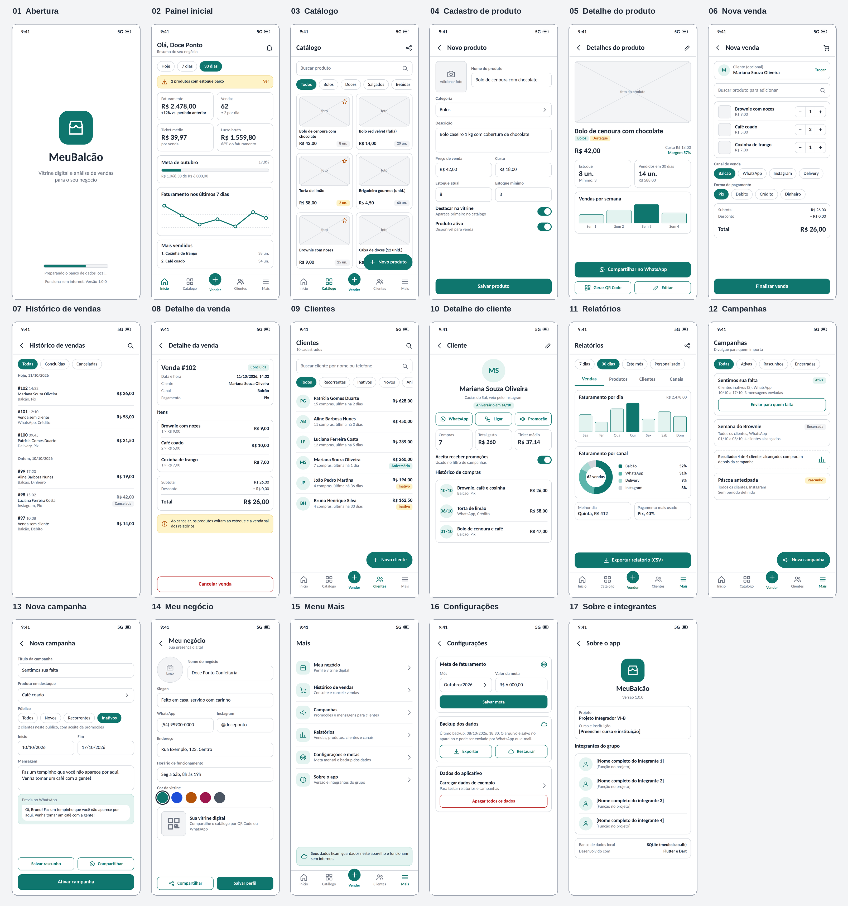](../assets/wireframes/00-visao-geral.png)

## 6.2 Mapa de navegação

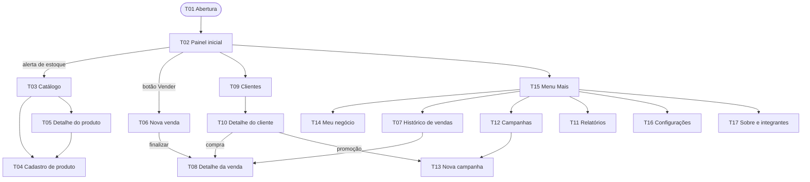

A navegação principal usa uma **barra inferior** com Início, Catálogo, Vender (botão central em destaque), Clientes e Mais. A venda, a ação mais frequente, fica sempre a um toque de distância.

## 6.3 Padrões de interface

| Elemento | Definição |
|---|---|
| Cor de ação | Verde-azulado `#0F766E` para botões principais, itens ativos e gráficos |
| Alerta | Âmbar para avisos (estoque baixo, inativos) e vermelho apenas para ações destrutivas |
| Tipografia | Fonte sem serifa, com títulos em negrito e textos de apoio em cinza |
| Botões | Altura mínima de 48 pontos para facilitar o toque |
| Textos | Em português, verbos de ação nos botões ("Finalizar venda", "Salvar produto") |
| Estados vazios e erros | Indicam o que fazer em seguida (ex.: "Cadastre seu primeiro produto") |

## 6.4 Telas

### T01 · Abertura

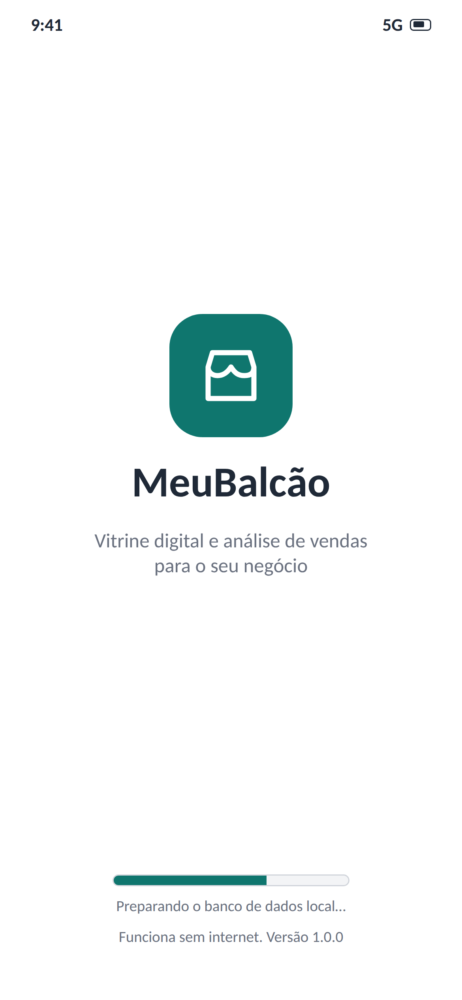

| | |
|---|---|
| **Objetivo** | Apresentar a marca enquanto o banco de dados local é aberto e o esquema é verificado. |
| **Elementos** | Logo, nome, slogan, barra de progresso e aviso de que o app funciona sem internet. |
| **Requisitos** | RNF01, RNF02 |
| **Tabelas utilizadas** | Abre/cria `meubalcao.db` |
| **Navegação** | Segue para T02 (Painel inicial). |

### T02 · Painel inicial

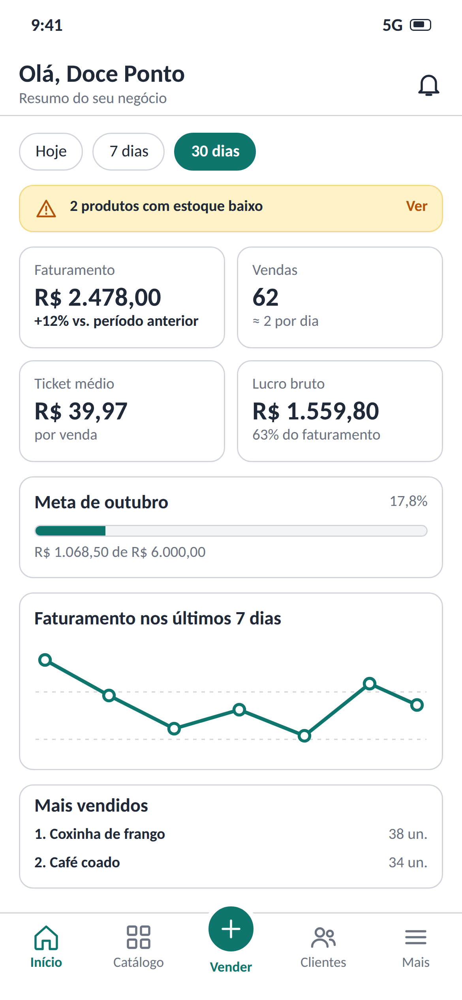

| | |
|---|---|
| **Objetivo** | Mostrar de imediato como está o negócio e o que precisa de atenção. |
| **Elementos** | Filtro de período (hoje, 7 e 30 dias), alerta de estoque baixo, quatro indicadores (faturamento, vendas, ticket médio, lucro bruto), meta do mês, gráfico dos últimos 7 dias e produtos mais vendidos. |
| **Requisitos** | RF09, RF21, RF22, RF23, RF24 |
| **Tabelas utilizadas** | `venda`, `item_venda`, `produto`, `meta_mensal` |
| **Navegação** | Alerta → T03. Botão central "Vender" → T06. Barra inferior: T03, T09, T15. |

### T03 · Catálogo

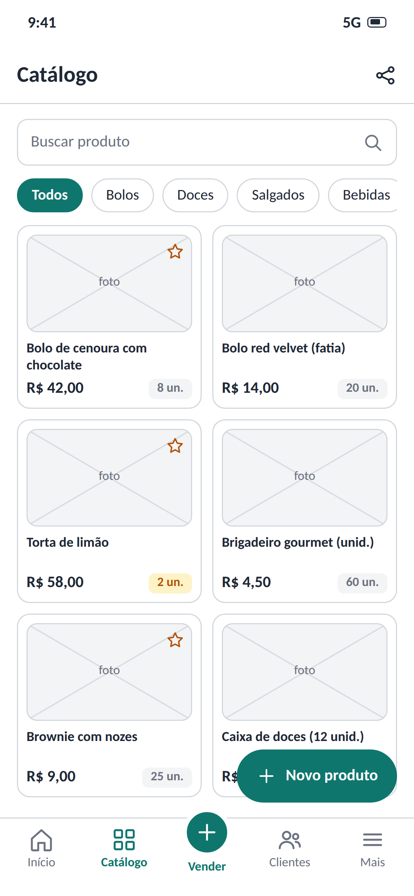

| | |
|---|---|
| **Objetivo** | Consultar, buscar e filtrar os produtos da vitrine. |
| **Elementos** | Busca, filtro por categoria, grade de produtos com foto, preço, estoque, estrela de destaque e selo amarelo para estoque baixo, botão "Novo produto" e atalho para compartilhar. |
| **Requisitos** | RF02, RF05, RF06, RF07, RF08, RF09 |
| **Tabelas utilizadas** | `produto`, `categoria` |
| **Navegação** | Produto → T05. "Novo produto" → T04. |

### T04 · Cadastro de produto

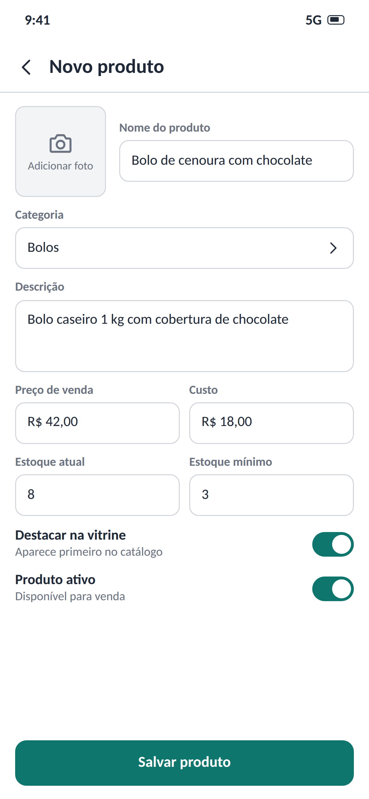

| | |
|---|---|
| **Objetivo** | Criar ou editar um produto com todos os dados necessários à venda e à vitrine. |
| **Elementos** | Foto, nome, categoria (com opção "Nova categoria"), descrição, preço, custo, estoque atual e mínimo, chaves de destaque e ativo. |
| **Requisitos** | RF05, RF06, RF08 |
| **Tabelas utilizadas** | `produto`, `categoria` |
| **Navegação** | Salvar volta para T03. |

### T05 · Detalhe do produto

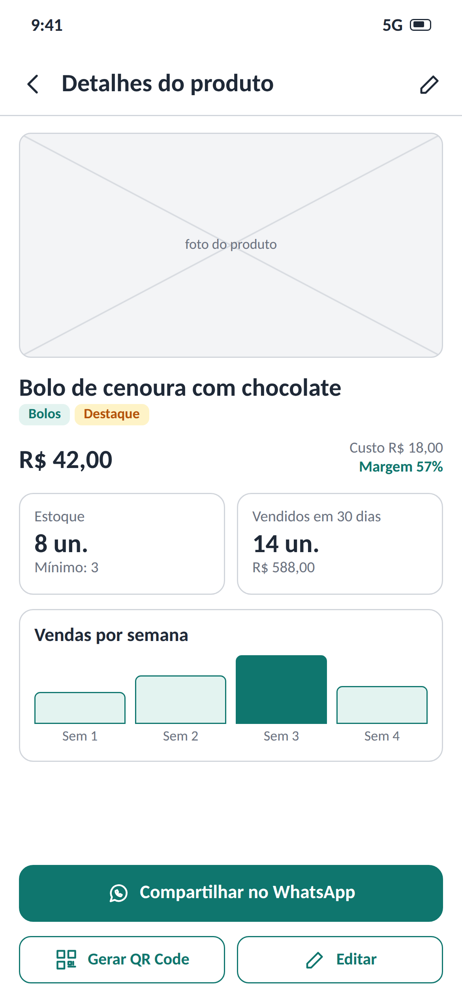

| | |
|---|---|
| **Objetivo** | Ver o desempenho do produto e divulgá-lo. |
| **Elementos** | Foto, preço, custo e margem, estoque, vendas dos últimos 30 dias, gráfico semanal e ações de compartilhar no WhatsApp, gerar QR Code e editar. |
| **Requisitos** | RF03, RF04, RF06 |
| **Tabelas utilizadas** | `produto`, `item_venda` |
| **Navegação** | Editar → T04. |

### T06 · Nova venda

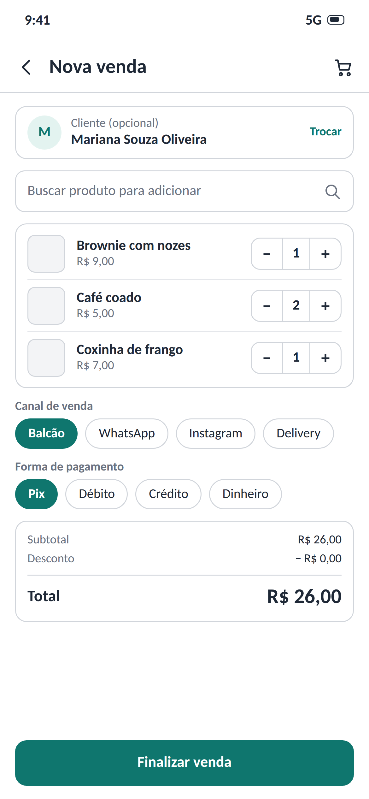

| | |
|---|---|
| **Objetivo** | Registrar uma venda em poucos toques. |
| **Elementos** | Cliente opcional, busca de produtos, itens com controle de quantidade, canal de venda, forma de pagamento, subtotal, desconto e total. |
| **Requisitos** | RF10, RN01 a RN04 |
| **Tabelas utilizadas** | `venda`, `item_venda`, `produto`, `cliente` |
| **Navegação** | Finalizar venda → T08 (comprovante da venda). |

### T07 · Histórico de vendas

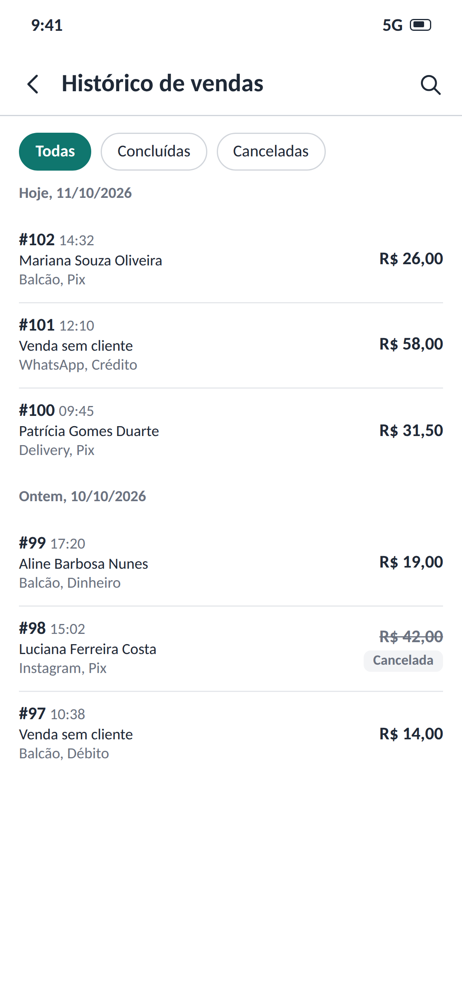

| | |
|---|---|
| **Objetivo** | Consultar as vendas realizadas por dia. |
| **Elementos** | Filtro por situação, vendas agrupadas por data, cliente, canal, forma de pagamento, valor e selo de cancelada (valor riscado). |
| **Requisitos** | RF12 |
| **Tabelas utilizadas** | `venda`, `cliente` |
| **Navegação** | Venda → T08. |

### T08 · Detalhe da venda

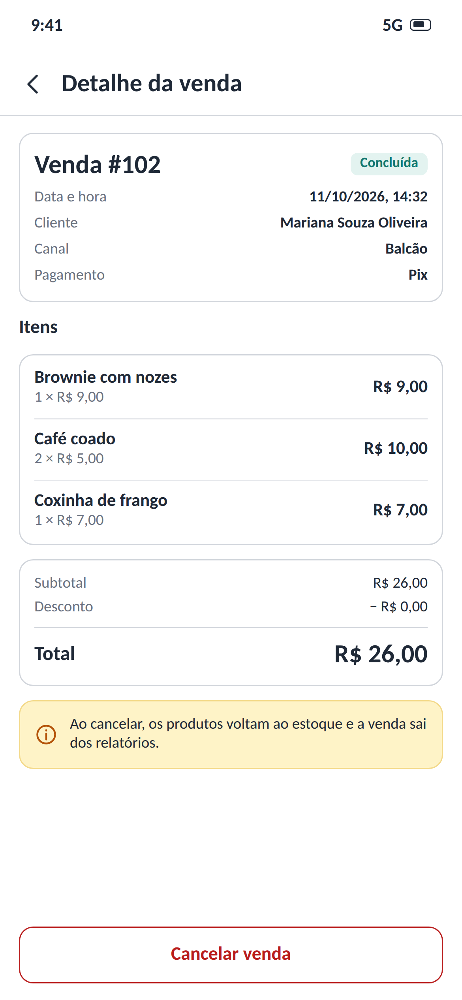

| | |
|---|---|
| **Objetivo** | Conferir uma venda e cancelá-la quando necessário. |
| **Elementos** | Dados da venda, itens com quantidade e preço, subtotal, desconto, total, aviso sobre o efeito do cancelamento e botão "Cancelar venda". |
| **Requisitos** | RF11, RF12, RN05 |
| **Tabelas utilizadas** | `venda`, `item_venda`, `produto` |
| **Navegação** | Cancelar → volta a T07. |

### T09 · Clientes

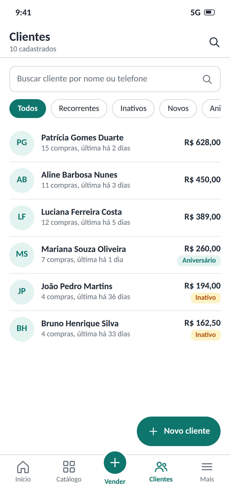

| | |
|---|---|
| **Objetivo** | Encontrar clientes e ver quais merecem atenção. |
| **Elementos** | Busca por nome ou telefone, segmentos (todos, recorrentes, inativos, novos, aniversário), compras, última compra, total gasto e selos de aniversário e inativo. |
| **Requisitos** | RF13, RF14 |
| **Tabelas utilizadas** | `cliente`, `venda` |
| **Navegação** | Cliente → T10. "Novo cliente" abre o cadastro. |

### T10 · Detalhe do cliente

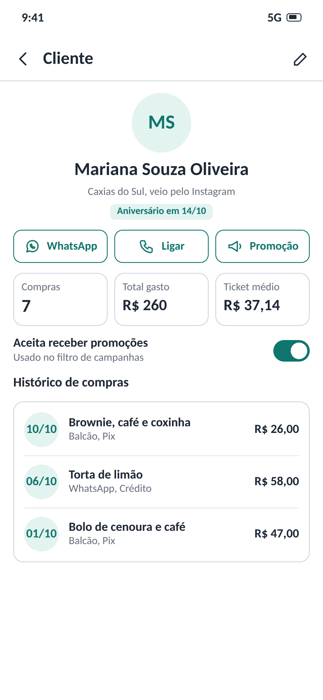

| | |
|---|---|
| **Objetivo** | Conhecer o cliente e entrar em contato. |
| **Elementos** | Dados de contato, aniversário, compras, total gasto, ticket médio, aceite de promoções, histórico de compras e botões WhatsApp, Ligar e Promoção. |
| **Requisitos** | RF13, RF15, RF16, RF19 |
| **Tabelas utilizadas** | `cliente`, `venda`, `item_venda` |
| **Navegação** | Compra → T08. Promoção → T13. |

### T11 · Relatórios

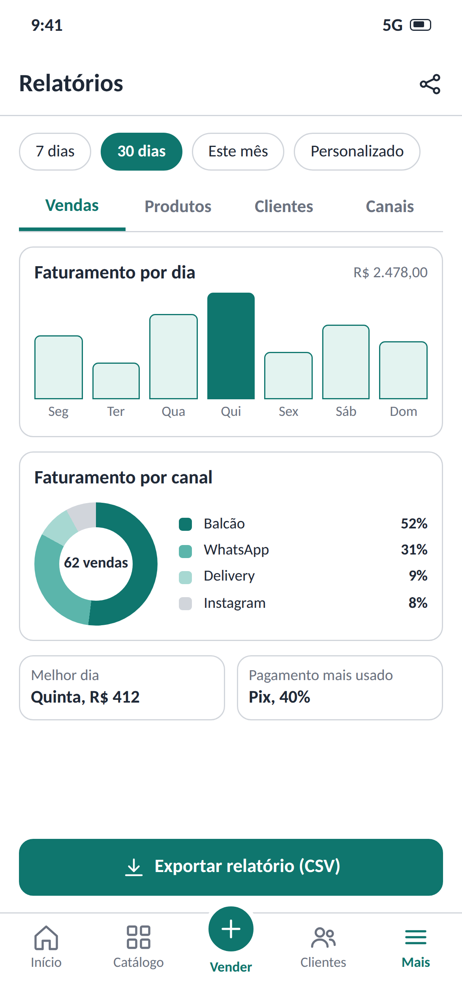

| | |
|---|---|
| **Objetivo** | Analisar o desempenho por período. |
| **Elementos** | Filtro de período, abas (vendas, produtos, clientes, canais), gráfico de faturamento por dia, gráfico por canal, melhor dia, pagamento mais usado e exportação em CSV. |
| **Requisitos** | RF23, RF24, RF25 |
| **Tabelas utilizadas** | `venda`, `item_venda`, `produto`, `cliente` |
| **Navegação** | Acessada pelo menu Mais (T15). |

### T12 · Campanhas

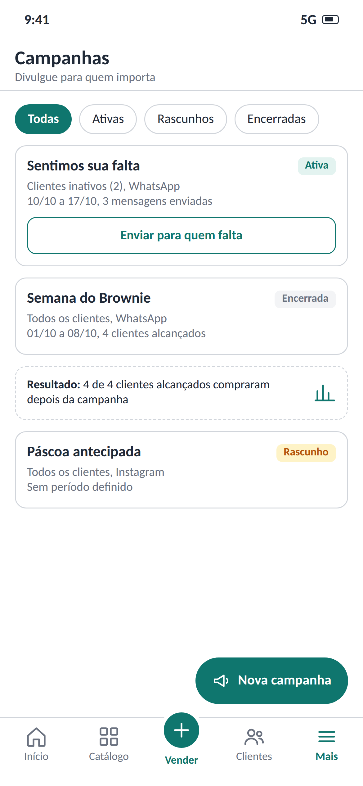

| | |
|---|---|
| **Objetivo** | Acompanhar as campanhas e seus resultados. |
| **Elementos** | Filtro por situação, cartões com público, canal, período e envios, botão de enviar para o público e resultado ("4 de 4 alcançados compraram depois"). |
| **Requisitos** | RF17, RF19, RF20 |
| **Tabelas utilizadas** | `campanha`, `envio_campanha`, `venda` |
| **Navegação** | "Nova campanha" → T13. |

### T13 · Nova campanha

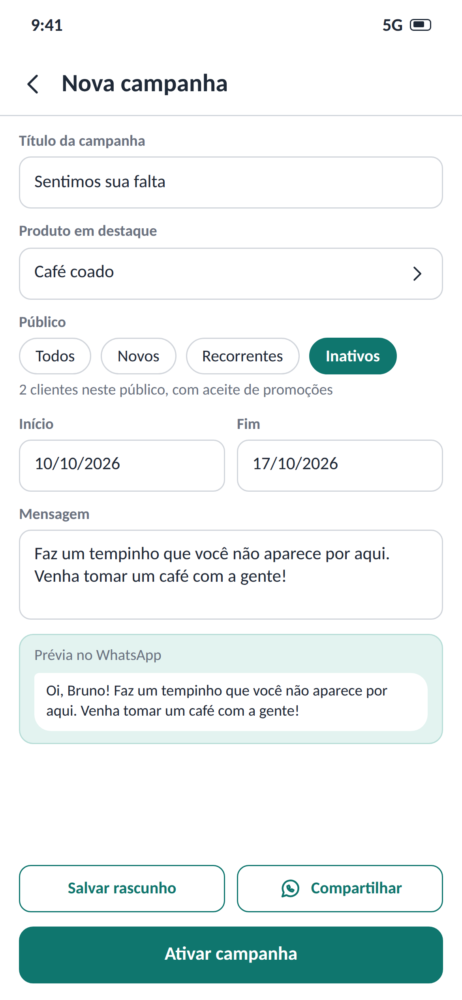

| | |
|---|---|
| **Objetivo** | Criar uma campanha direcionada e compartilhá-la. |
| **Elementos** | Título, produto em destaque, público (segmento), período, mensagem, prévia da mensagem no WhatsApp e botões salvar rascunho, compartilhar e ativar. |
| **Requisitos** | RF17, RF18, RF19, RN09 |
| **Tabelas utilizadas** | `campanha`, `produto`, `cliente`, `envio_campanha` |
| **Navegação** | Salvar volta para T12. |

### T14 · Meu negócio

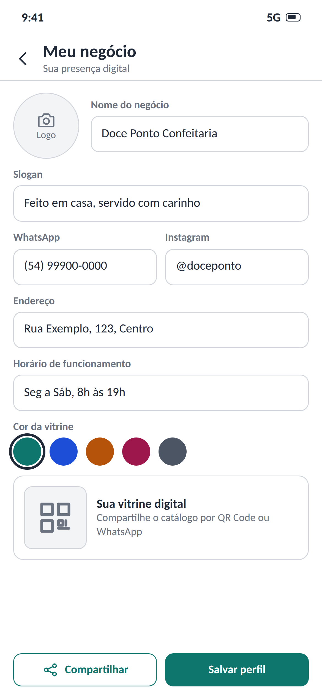

| | |
|---|---|
| **Objetivo** | Montar a identidade digital do negócio. |
| **Elementos** | Logo, nome, slogan, WhatsApp, Instagram, endereço, horário, cor da vitrine, cartão com QR Code e botões compartilhar e salvar. |
| **Requisitos** | RF01, RF02, RF03 |
| **Tabelas utilizadas** | `perfil_negocio` |
| **Navegação** | Acessada pelo menu Mais (T15). |

### T15 · Menu Mais

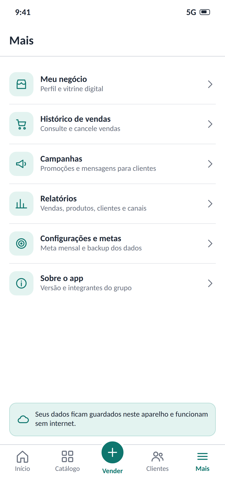

| | |
|---|---|
| **Objetivo** | Reunir as funções menos frequentes. |
| **Elementos** | Atalhos para Meu negócio, Histórico de vendas, Campanhas, Relatórios, Configurações e metas e Sobre o app. |
| **Requisitos** | RF28 |
| **Tabelas utilizadas** | — |
| **Navegação** | T14, T07, T12, T11, T16 e T17. |

### T16 · Configurações

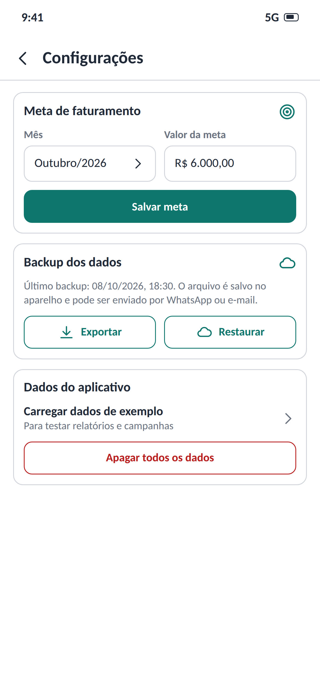

| | |
|---|---|
| **Objetivo** | Definir a meta do mês e cuidar dos dados do aplicativo. |
| **Elementos** | Mês e valor da meta, exportar e restaurar backup, carregar dados de exemplo e apagar todos os dados. |
| **Requisitos** | RF22, RF26, RF27 |
| **Tabelas utilizadas** | `meta_mensal`, arquivo `meubalcao.db` |
| **Navegação** | Acessada pelo menu Mais (T15). |

### T17 · Sobre o app e integrantes

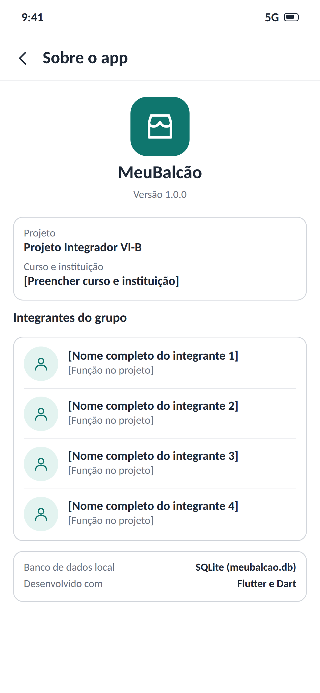

| | |
|---|---|
| **Objetivo** | Atender ao requisito de exibir o **nome completo de todos os integrantes do grupo**. |
| **Elementos** | Logo, versão, projeto, curso e instituição, lista de integrantes e tecnologias utilizadas. Detalhes no [item 7](07-tela-integrantes.md). |
| **Requisitos** | RF28 |
| **Tabelas utilizadas** | — (dados fixos no código) |
| **Navegação** | Acessada pelo menu Mais (T15). |

## 6.5 Rastreabilidade: requisitos × telas

Todos os requisitos funcionais do [item 4](04-caracteristicas.md) possuem ao menos uma tela correspondente (coluna "Telas" das tabelas de requisitos). As telas T01 e T15 dão suporte à abertura do banco e à navegação, e a T17 atende ao requisito de identificação do grupo.
