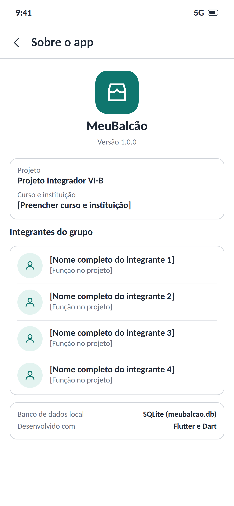
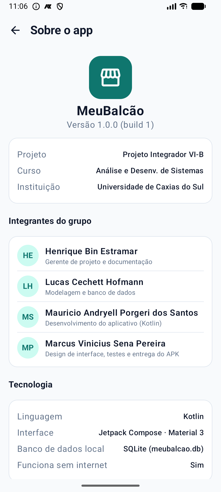

# 7. Tela com o nome completo dos integrantes

O aplicativo tem uma tela chamada **"Sobre o app"** (T17), que exibe o **nome completo de todos os integrantes do grupo**, além da versão, do nome do projeto e das principais tecnologias.

| Wireframe (Etapa 1) | Tela implementada (Etapa 2) |
|---|---|
|  |  |

## 7.1 Onde a tela fica no aplicativo

- **Caminho:** barra inferior → **Mais** → **Sobre o app** (T15 → T17).
- Funciona **sem login e sem internet**, pois não depende do banco de dados: os nomes ficam fixos no código do aplicativo.
- O requisito também aparece como **RF28** em [Características](04-caracteristicas.md).

## 7.2 Conteúdo da tela

| Bloco | Conteúdo |
|---|---|
| Identificação | Ícone, nome **MeuBalcão**, versão e número do build (lidos de `BuildConfig`) |
| Projeto | Projeto Integrador VI-B, curso e instituição |
| Integrantes do grupo | **Nome completo** de cada integrante e sua função no projeto |
| Tecnologia | Kotlin, Jetpack Compose, SQLite local e funcionamento offline |

## 7.3 Integrantes

| Nome completo | Função no projeto |
|---|---|
| Henrique Bin Estramar                | Gerente de projeto e documentação |
| Lucas Cechett Hofmann                | Modelagem e banco de dados |
| Mauricio Andryell Porgeri dos Santos | Desenvolvimento do aplicativo (Kotlin) |
| Marcus Vinicius Sena Pereira         | Design de interface, testes e entrega do APK |

## 7.4 Como foi implementada

A lista de integrantes fica em uma constante. Para atualizar a tela, basta editar um único arquivo: [`ui/screens/ConfigSobreScreens.kt`](../app/src/main/java/com/meubalcao/app/ui/screens/ConfigSobreScreens.kt).

```kotlin
/** Integrante do grupo: os nomes ficam fixos no código (RF28). */
data class Integrante(val nome: String, val funcao: String)

val integrantes = listOf(
    Integrante("Henrique Bin Estramar", "Gerente de projeto e documentação"),
    Integrante("Lucas Cechett Hofmann", "Modelagem e banco de dados"),
    Integrante("Mauricio Andryell Porgeri dos Santos", "Desenvolvimento do aplicativo (Kotlin)"),
    Integrante("Marcus Vinicius Sena Pereira", "Design de interface, testes e entrega do APK"),
)

/** T17 · Sobre o app e integrantes do grupo (RF28). Não usa o banco de dados. */
@Composable
fun SobreScreen(nav: NavController) {
    Tela("Sobre o app", voltar = { nav.popBackStack() }) { pad ->
        Column(Modifier.fillMaxSize().padding(pad).verticalScroll(rememberScrollState()).padding(16.dp)) {
            Text("MeuBalcão", fontWeight = FontWeight.Bold, fontSize = 24.sp)
            Text("Versão ${BuildConfig.VERSION_NAME} (build ${BuildConfig.VERSION_CODE})")
            // ... projeto, curso e instituição
            Secao("Integrantes do grupo")
            Cartao {
                integrantes.forEach { p ->
                    Row {
                        Avatar(p.nome, 40.dp)
                        Column {
                            Text(p.nome, fontWeight = FontWeight.SemiBold)
                            Text(p.funcao)
                        }
                    }
                }
            }
            // ... tecnologia
        }
    }
}
```

A versão exibida vem do `versionName` definido em `app/build.gradle.kts`. Assim, a tela acompanha cada nova versão do APK.

## 7.5 Teste automatizado

Um teste garante que a lista continua com os quatro integrantes e com nomes completos ([`FormatosTest.kt`](../app/src/test/java/com/meubalcao/app/FormatosTest.kt)):

```kotlin
@Test
fun `tela Sobre lista os quatro integrantes com nome completo`() {
    assertEquals(4, integrantes.size)
    assertTrue(integrantes.all { it.nome.split(" ").size >= 3 })
}
```

## 7.6 Critérios de aceite

- [x] A tela é acessível pelo menu **Mais → Sobre o app**.
- [x] Todos os integrantes aparecem com o **nome completo**.
- [x] A tela abre normalmente com o aparelho **em modo avião**.
- [x] Os nomes na tela são **idênticos** aos listados neste repositório.
- [x] A captura da tela real está anexada acima (`assets/screenshots/09-sobre-integrantes.png`).
