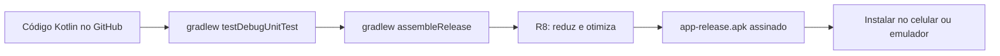

# 8. Como o arquivo APK é gerado

O aplicativo é escrito em **Kotlin** com **Jetpack Compose** e compilado pelo **Gradle** (Android Gradle Plugin). O Gradle compila o código, empacota os recursos e os scripts SQL do banco, otimiza tudo com o **R8** e gera um único arquivo **`.apk`**, que pode ser instalado em aparelhos Android 8.0 ou superior.

> **Mudança em relação à Etapa 1:** o planejamento previa Flutter/Dart. Na implementação, o grupo usou **Kotlin nativo** porque o Android Studio, o Android SDK e o emulador já estavam instalados e prontos. O banco de dados, as telas e os requisitos continuam os mesmos.

**APK pronto para instalar:** [`apk/MeuBalcao-1.0.0.apk`](../apk/MeuBalcao-1.0.0.apk) (cerca de 1,4 MB)

## 8.1 Visão geral do processo



| Tipo de arquivo | Para quê | Comando |
|---|---|---|
| **APK de teste (debug)** | Desenvolvimento e depuração | `gradlew assembleDebug` |
| **APK de distribuição (release)** | Entrega do trabalho, otimizado pelo R8 | `gradlew assembleRelease` |
| **App Bundle (AAB)** | Somente para publicar na Google Play | `gradlew bundleRelease` |

## 8.2 Preparar o ambiente

1. Instalar o **[Android Studio](https://developer.android.com/studio)**, que traz o Android SDK, o emulador e o JDK 21 (pasta `jbr`).
2. Instalar o **[Git](https://git-scm.com)** e clonar o repositório:

```bash
git clone https://github.com/Marcus-Monaco/projeto-integrador-2026-2.git
cd projeto-integrador-2026-2
```

3. Abrir a pasta no Android Studio (*File → Open*). Ele cria o arquivo `local.properties` com o caminho do SDK e baixa as dependências automaticamente.

Não é preciso instalar o Gradle: o repositório traz o **Gradle Wrapper** (`gradlew` / `gradlew.bat`), que baixa a versão correta (8.14.3) na primeira execução.

## 8.3 Configuração do projeto

| Arquivo | O que define |
|---|---|
| [`settings.gradle.kts`](../settings.gradle.kts) | Nome do projeto e repositórios (Google e Maven Central) |
| [`build.gradle.kts`](../build.gradle.kts) | Versões dos plugins: Android Gradle Plugin 8.12, Kotlin 2.1.20 e o compilador do Compose |
| [`app/build.gradle.kts`](../app/build.gradle.kts) | `applicationId = "com.meubalcao.app"`, `minSdk = 26` (Android 8.0), `targetSdk = 36`, `versionCode = 1`, `versionName = "1.0.0"`, bibliotecas e assinatura |
| [`app/src/main/AndroidManifest.xml`](../app/src/main/AndroidManifest.xml) | Nome exibido (`MeuBalcão`), ícone, tela inicial e `FileProvider` para compartilhar arquivos |
| `app/build.gradle.kts` → `assets.srcDirs("../database")` | Empacota `database/schema.sql` e `database/seed.sql` dentro do APK |

O aplicativo **não declara a permissão de internet**: o banco é local. O manifesto declara apenas as `<queries>` necessárias para abrir o WhatsApp, o discador e a folha de compartilhamento do Android.

## 8.4 Assinatura do APK

O Android só instala APKs **assinados**. O `app/build.gradle.kts` funciona de duas formas:

- **Sem chave própria** (como no APK entregue): o APK de release é assinado com a **chave de depuração** do Android Studio. Ele instala normalmente em qualquer aparelho ou emulador e serve para a avaliação do trabalho.
- **Com chave própria** (para publicar ou distribuir atualizações): crie a chave uma única vez:

```bash
keytool -genkey -v -keystore meubalcao-keystore.jks -keyalg RSA -keysize 2048 -validity 10000 -alias upload
```

Depois crie `key.properties` na raiz do projeto. O arquivo **nunca vai para o GitHub**, porque está no [`.gitignore`](../.gitignore):

```properties
storePassword=SENHA_DA_CHAVE
keyPassword=SENHA_DA_CHAVE
keyAlias=upload
storeFile=C:/caminho/para/meubalcao-keystore.jks
```

Quando esse arquivo existe, o Gradle passa a usá-lo automaticamente:

```kotlin
// app/build.gradle.kts (trecho)
val keystoreProperties = Properties().apply {
    val arquivo = rootProject.file("key.properties")
    if (arquivo.exists()) arquivo.inputStream().use { load(it) }
}
android {
    signingConfigs {
        create("release") {
            if (keystoreProperties.isNotEmpty()) {
                storeFile = file(keystoreProperties.getProperty("storeFile"))
                storePassword = keystoreProperties.getProperty("storePassword")
                keyAlias = keystoreProperties.getProperty("keyAlias")
                keyPassword = keystoreProperties.getProperty("keyPassword")
            }
        }
    }
    buildTypes {
        release {
            isMinifyEnabled = true      // R8 remove código não usado
            isShrinkResources = true    // remove recursos não usados
            signingConfig = if (keystoreProperties.isNotEmpty())
                signingConfigs.getByName("release") else signingConfigs.getByName("debug")
        }
    }
}
```

## 8.5 Gerar o APK

Na raiz do repositório (Windows: `gradlew.bat`; Linux/macOS: `./gradlew`):

```bash
gradlew testDebugUnitTest   # 18 testes automatizados (banco e regras)
gradlew assembleRelease     # gera o APK otimizado
```

Também é possível usar o menu do Android Studio: *Build → Generate App Bundles or APKs → Generate APKs*.

Resultado:

```text
app/build/outputs/apk/release/app-release.apk
```

A cópia entregue fica em [`apk/MeuBalcao-1.0.0.apk`](../apk/MeuBalcao-1.0.0.apk). Com cerca de 1,4 MB, ela atende ao requisito RNF09 (APK abaixo de 30 MB).

## 8.6 Instalar e testar o APK

| Forma | Passos |
|---|---|
| **Emulador** | No Android Studio, abrir *Device Manager*, iniciar um dispositivo e arrastar o `.apk` para a janela do emulador (ou clicar em ▶ *Run* para rodar direto do código) |
| **Cabo USB** | Ativar a *Depuração USB* no celular e executar `adb install apk/MeuBalcao-1.0.0.apk` |
| **Arquivo** | Enviar o `.apk` para o celular (cabo, e-mail, nuvem ou WhatsApp), abri-lo e permitir a instalação de **fontes desconhecidas** |

**Roteiro de teste executado**, com o aparelho em **modo avião**:

1. Abrir o aplicativo: a tela de abertura cria o banco local `meubalcao.db`.
2. Tocar em **Carregar dados de exemplo** no painel.
3. Registrar uma venda com o botão central **+** e conferir a baixa do estoque no Catálogo.
4. Abrir o painel e os relatórios e conferir os números.
5. Fechar o aplicativo, abri-lo de novo e verificar que os dados continuam salvos.
6. Abrir **Mais → Sobre o app** e conferir os nomes dos integrantes.

## 8.7 Problemas comuns

| Sintoma | Solução provável |
|---|---|
| `SDK location not found` | Abrir o projeto no Android Studio uma vez (ele cria o `local.properties`) ou criar o arquivo com `sdk.dir=C:\\Users\\<você>\\AppData\\Local\\Android\\Sdk` |
| Erro de versão do Java | Usar o JDK do Android Studio: `set JAVA_HOME=C:\Program Files\Android\Android Studio\jbr` |
| O celular não instala o APK | Permitir "instalar apps desconhecidos" e conferir se o Android é 8.0 ou superior |
| "App não instalado" ao atualizar | O novo APK precisa estar assinado com a **mesma chave** e ter `versionCode` maior |
