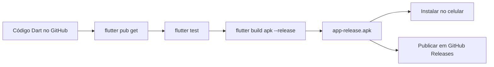

# 8. Como será gerado o arquivo APK

O aplicativo será desenvolvido em **Flutter**, que compila o código Dart e empacota tudo (código, imagens e o script SQL do banco) em um único arquivo **`.apk`** instalável em aparelhos Android. Este documento descreve o passo a passo planejado. Os comandos seguem a documentação oficial: [docs.flutter.dev/deployment/android](https://docs.flutter.dev/deployment/android).

**Resultado final:** `build/app/outputs/flutter-apk/app-release.apk`

## 8.1 Visão geral do processo



| Tipo de arquivo | Para quê | Comando |
|---|---|---|
| **APK de teste (debug)** | Testar rapidamente durante o desenvolvimento | `flutter build apk --debug` |
| **APK de distribuição (release)** | Entrega do trabalho e instalação nos celulares | `flutter build apk --release` |
| **APK por arquitetura** | Arquivos menores, um para cada tipo de processador | `flutter build apk --split-per-abi` |
| **App Bundle (AAB)** | Somente se o app for publicado na Google Play | `flutter build appbundle` |

## 8.2 Preparar o ambiente

Instalar, em Windows, macOS ou Linux:

1. **Flutter SDK** (canal *stable*), adicionando a pasta `flutter/bin` ao `PATH`.
2. **Android Studio**, que traz o Android SDK, o emulador e o JDK necessários.
3. **Git**, para clonar o repositório.

Depois, verificar a instalação e aceitar as licenças do Android:

```bash
flutter doctor
flutter doctor --android-licenses
```

O `flutter doctor` deve mostrar o item **Android toolchain** sem pendências.

## 8.3 Criar e configurar o projeto

```bash
# 1. Criar o projeto somente para Android
flutter create --org com.meubalcao --project-name meubalcao --platforms=android .

# 2. Adicionar as bibliotecas (lista completa no item 9)
flutter pub add sqflite path path_provider provider fl_chart intl image_picker \
    share_plus url_launcher qr_flutter csv file_picker package_info_plus
flutter pub add dev:flutter_launcher_icons dev:sqflite_common_ffi

# 3. Baixar as dependências
flutter pub get
```

Ajustes de identidade do aplicativo:

| Arquivo | O que configurar |
|---|---|
| `pubspec.yaml` | `version: 1.0.0+1` (versão exibida + número de build, que deve aumentar a cada novo APK) e a pasta `assets/db/` com o script do banco |
| `android/app/build.gradle` (ou `build.gradle.kts`) | `applicationId "com.meubalcao.app"` (altere somente o `applicationId`) |
| `android/app/src/main/AndroidManifest.xml` | `android:label="MeuBalcão"` (nome exibido sob o ícone) |
| Ícone | Colocar a imagem em `assets/icon/icon.png`, configurar `flutter_launcher_icons` no `pubspec.yaml` e executar `dart run flutter_launcher_icons` |

O aplicativo **não precisa da permissão de internet** para o banco de dados local. Se for usado o envio por WhatsApp (`url_launcher`), pode ser necessário declarar a consulta a pacotes externos no `AndroidManifest.xml`, conforme a documentação da biblioteca.

## 8.4 Assinar o APK (chave de assinatura)

O Android só instala APKs **assinados**. Para o APK de entrega, criamos uma chave própria **uma única vez**:

```bash
# Linux e macOS
keytool -genkey -v -keystore ~/meubalcao-keystore.jks -keyalg RSA -keysize 2048 -validity 10000 -alias upload

# Windows (PowerShell)
keytool -genkey -v -keystore $env:USERPROFILE\meubalcao-keystore.jks -storetype JKS -keyalg RSA -keysize 2048 -validity 10000 -alias upload
```

Em seguida, criar o arquivo `android/key.properties` (**nunca enviar ao GitHub**):

```properties
storePassword=SENHA_DA_CHAVE
keyPassword=SENHA_DA_CHAVE
keyAlias=upload
storeFile=C:/caminho/para/meubalcao-keystore.jks
```

E ligá-lo ao build em `android/app/build.gradle` (versão Groovy; em projetos com `build.gradle.kts` a sintaxe é equivalente, conforme a documentação oficial):

```groovy
def keystoreProperties = new Properties()
def keystorePropertiesFile = rootProject.file('key.properties')
if (keystorePropertiesFile.exists()) {
    keystoreProperties.load(new FileInputStream(keystorePropertiesFile))
}

android {
    signingConfigs {
        release {
            keyAlias keystoreProperties['keyAlias']
            keyPassword keystoreProperties['keyPassword']
            storeFile keystoreProperties['storeFile'] ? file(keystoreProperties['storeFile']) : null
            storePassword keystoreProperties['storePassword']
        }
    }
    buildTypes {
        release {
            signingConfig signingConfigs.release
        }
    }
}
```

> 🔒 **Segurança:** o arquivo `.jks` e o `key.properties` estão no [`.gitignore`](../.gitignore) do repositório. Guarde uma cópia da chave em local seguro: sem ela não é possível lançar atualizações do mesmo aplicativo.

## 8.5 Gerar o APK

Na raiz do projeto Flutter:

```bash
flutter clean
flutter pub get
flutter test
flutter build apk --release
```

O comando compila, otimiza, assina e gera o arquivo:

```text
build/app/outputs/flutter-apk/app-release.apk
```

Para gerar arquivos menores, um por arquitetura de processador, usar `--split-per-abi`. Serão criados, por exemplo, `app-arm64-v8a-release.apk` (a maioria dos celulares atuais), `app-armeabi-v7a-release.apk` e `app-x86_64-release.apk`.

## 8.6 Instalar e testar o APK

| Forma | Passos |
|---|---|
| **Cabo USB** | Ativar a *Depuração USB* no celular e executar `flutter install` ou `adb install build/app/outputs/flutter-apk/app-release.apk` |
| **Emulador** | Criar um dispositivo no *Device Manager* do Android Studio e executar `flutter run --release` |
| **Arquivo** | Enviar o `.apk` para o celular (cabo, e-mail, nuvem ou WhatsApp), abri-lo e permitir a instalação de **fontes desconhecidas** quando o Android solicitar |

**Roteiro mínimo de teste do APK**, com o aparelho em **modo avião**:

1. Abrir o aplicativo e confirmar que a tela de abertura carrega o banco local.
2. Cadastrar uma categoria e um produto.
3. Registrar uma venda e conferir a baixa do estoque.
4. Abrir o painel e os relatórios, e conferir os números.
5. Fechar o aplicativo, abri-lo novamente e verificar se os dados continuam salvos.
6. Abrir **Mais → Sobre o app** e conferir os nomes dos integrantes.

## 8.7 Publicar o APK no GitHub

O APK de cada versão será anexado a uma **Release** do repositório, para que professores e colegas possam baixá-lo:

```bash
git tag v1.0.0
git push origin v1.0.0
gh release create v1.0.0 build/app/outputs/flutter-apk/app-release.apk \
    --title "MeuBalcão 1.0.0" --notes "Primeira versão instalável."
```

(Também é possível criar a Release pela página do repositório, em *Releases → Draft a new release*, anexando o arquivo.)

## 8.8 Automação com GitHub Actions (opcional)

Quando o código do app estiver no repositório, o APK poderá ser gerado automaticamente na nuvem. O arquivo abaixo seria salvo em `.github/workflows/build-apk.yml`:

```yaml
name: Gerar APK

on:
  workflow_dispatch:
  push:
    tags: ['v*']

jobs:
  apk:
    runs-on: ubuntu-latest
    steps:
      - uses: actions/checkout@v4
      - uses: actions/setup-java@v4
        with:
          distribution: temurin
          java-version: '17'
      - uses: subosito/flutter-action@v2
        with:
          channel: stable
          cache: true
      - run: flutter pub get
      - run: flutter test
      - run: flutter build apk --release
      - uses: actions/upload-artifact@v4
        with:
          name: meubalcao-apk
          path: build/app/outputs/flutter-apk/app-release.apk
```

Sem os segredos da chave de assinatura configurados no GitHub, o APK gerado serve apenas para testes. Para o APK de entrega, usar a máquina local, conforme o item 8.5.

## 8.9 Problemas comuns

| Sintoma | Solução provável |
|---|---|
| `flutter doctor` acusa licenças pendentes | Executar `flutter doctor --android-licenses` e aceitar todas |
| Erro de versão do Java/Gradle | Usar o JDK que acompanha o Android Studio e executar `flutter clean` |
| O celular não instala o APK | Permitir "instalar apps desconhecidos" e conferir se o Android é 8.0 ou superior |
| "App não instalado" ao atualizar | O novo APK precisa estar assinado com a **mesma chave** e ter `versionCode` maior |
| Banco de dados não é criado | Conferir se `assets/db/schema.sql` está declarado em `assets` no `pubspec.yaml` |
