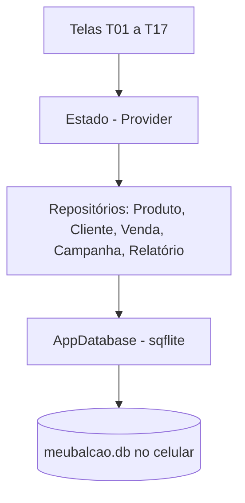

# 10. Banco de dados local: qual será usado e como será implementado

## 10.1 Banco escolhido: SQLite

O MeuBalcão usará o **SQLite**, um banco de dados relacional que roda **dentro do próprio aplicativo**, sem servidor, e que já faz parte do Android. No Flutter, o acesso será feito pela biblioteca [`sqflite`](https://pub.dev/packages/sqflite).

| Pergunta | Resposta |
|---|---|
| Onde os dados ficam? | No celular em que o app está instalado, em um único arquivo: **`meubalcao.db`** |
| Funciona sem internet? | **Sim.** O banco é local: criação, leitura e gravação não usam rede em nenhum momento. |
| Precisa de servidor ou instalação extra? | Não. |
| Os dados são mantidos ao fechar o app? | Sim. Eles só são apagados se o usuário limpar os dados do app, desinstalá-lo ou usar a função "Apagar todos os dados". |
| Outros aplicativos acessam o arquivo? | Não. Ele fica no armazenamento privado do app (`/data/data/<applicationId>/databases/`). |

**Por que SQLite?** Atende ao requisito da disciplina (banco local que funciona offline), é relacional (permite chaves estrangeiras, transações e consultas agregadas, essenciais para os relatórios) e é leve o bastante para aparelhos de entrada.

## 10.2 Modelo de dados

O banco possui **9 tabelas** (`perfil_negocio`, `categoria`, `produto`, `cliente`, `venda`, `item_venda`, `campanha`, `envio_campanha`, `meta_mensal`). O diagrama, o dicionário de dados e as restrições estão em [Modelo ER](05-modelo-er.md). O script de criação está em [`database/schema.sql`](../database/schema.sql).

## 10.3 Arquitetura da implementação

O acesso ao banco fica isolado em camadas, de modo que as telas nunca escrevem SQL diretamente:



Estrutura de pastas planejada para o código:

```text
lib/
├── main.dart
├── core/
│   └── db/app_database.dart        ← abre o banco, cria tabelas, controla versões
├── data/
│   ├── models/                     ← Produto, Cliente, Venda, ItemVenda, Campanha...
│   └── repositories/               ← consultas e gravações de cada módulo
├── state/                          ← provedores de estado (ChangeNotifier)
└── ui/
    ├── screens/                    ← uma pasta por tela dos wireframes
    └── widgets/
assets/
└── db/
    ├── schema.sql                  ← cópia de database/schema.sql
    └── seed.sql                    ← dados de exemplo (opcional)
```

No `pubspec.yaml`, a pasta `assets/db/` é declarada em `flutter: assets:` para que o script SQL seja empacotado no APK.

## 10.4 Abertura do banco e criação das tabelas

Uma única classe (padrão *singleton*) abre o banco, **ativa as chaves estrangeiras** e executa o `schema.sql` na primeira vez que o aplicativo é aberto:

```dart
// lib/core/db/app_database.dart
import 'package:flutter/services.dart' show rootBundle;
import 'package:path/path.dart' as p;
import 'package:sqflite/sqflite.dart';

class AppDatabase {
  AppDatabase._();
  static final AppDatabase instance = AppDatabase._();

  static const _nomeArquivo = 'meubalcao.db';
  static const _versao = 1;

  Database? _db;

  Future<Database> get database async => _db ??= await _abrir();

  Future<Database> _abrir() async {
    final caminho = p.join(await getDatabasesPath(), _nomeArquivo);
    return openDatabase(
      caminho,
      version: _versao,
      // Executado a cada abertura: sem isto o SQLite ignora as chaves estrangeiras.
      onConfigure: (db) async => db.execute('PRAGMA foreign_keys = ON'),
      // Executado somente quando o arquivo ainda não existe.
      onCreate: (db, versao) async {
        final script = await rootBundle.loadString('assets/db/schema.sql');
        final comandos = script
            .split('\n')
            .where((linha) => !linha.trimLeft().startsWith('--'))
            .join('\n')
            .split(';')
            .map((c) => c.trim())
            .where((c) => c.isNotEmpty && !c.toUpperCase().startsWith('PRAGMA'));
        for (final sql in comandos) {
          await db.execute(sql);
        }
      },
      // Executado quando a versão do app exige alterar um banco já existente.
      onUpgrade: (db, antiga, nova) async {
        // Exemplo de migração futura:
        // if (antiga < 2) {
        //   await db.execute('ALTER TABLE produto ADD COLUMN codigo_barras TEXT');
        // }
      },
    );
  }

  Future<void> fechar() async {
    await _db?.close();
    _db = null;
  }
}
```

**Como o funcionamento offline é garantido:** `openDatabase` apenas abre um arquivo local. Nenhuma parte do código de acesso a dados usa `http`, `socket` ou serviços em nuvem, e o aplicativo não solicita a permissão de internet para o banco.

## 10.5 Operações de leitura e gravação (repositórios)

### Registrar uma venda (transação)

Uma venda grava em três tabelas ao mesmo tempo. Se qualquer passo falhar (por exemplo, estoque insuficiente), o `CHECK (estoque_atual >= 0)` do banco rejeita o `UPDATE` e **toda a transação é desfeita**:

```dart
// lib/data/repositories/venda_repository.dart
class VendaRepository {
  Future<int> registrar(
    Map<String, Object?> venda,
    List<Map<String, Object?>> itens,
  ) async {
    final db = await AppDatabase.instance.database;
    return db.transaction((txn) async {
      final vendaId = await txn.insert('venda', venda);
      for (final item in itens) {
        await txn.insert('item_venda', {...item, 'venda_id': vendaId});
        await txn.rawUpdate(
          'UPDATE produto SET estoque_atual = estoque_atual - ? WHERE id = ?',
          [item['quantidade'], item['produto_id']],
        );
      }
      return vendaId;
    });
  }

  Future<void> cancelar(int vendaId) async {
    final db = await AppDatabase.instance.database;
    await db.transaction((txn) async {
      await txn.rawUpdate(
        "UPDATE venda SET status = 'CANCELADA' WHERE id = ? AND status = 'CONCLUIDA'",
        [vendaId],
      );
      await txn.rawUpdate('''
        UPDATE produto SET estoque_atual = estoque_atual +
          (SELECT SUM(quantidade) FROM item_venda
            WHERE venda_id = ? AND produto_id = produto.id)
        WHERE id IN (SELECT produto_id FROM item_venda WHERE venda_id = ?)
      ''', [vendaId, vendaId]);
    });
  }
}
```

> Os comandos SQL acima (venda com baixa de estoque, cancelamento com devolução e *rollback* por estoque insuficiente) foram executados e conferidos no SQLite com o `schema.sql` e o `seed.sql` do repositório.

### Alimentar o painel (consulta agregada)

```dart
Future<Map<String, Object?>> indicadores30Dias() async {
  final db = await AppDatabase.instance.database;
  final linhas = await db.rawQuery('''
    SELECT COUNT(*) AS vendas,
           ROUND(COALESCE(SUM(valor_total), 0), 2) AS faturamento,
           ROUND(COALESCE(AVG(valor_total), 0), 2) AS ticket_medio
    FROM venda
    WHERE status = 'CONCLUIDA'
      AND date(data_hora) >= date('now', 'localtime', '-29 days')
  ''');
  return linhas.first;
}
```

### Consultas analíticas prontas

O arquivo [`database/consultas.sql`](../database/consultas.sql) reúne as 11 consultas que alimentam o painel, os relatórios e as campanhas. Todas foram testadas com os dados de exemplo.

| Consulta | Alimenta | Requisito |
|---|---|---|
| Vendas, faturamento e ticket médio | Painel (T02) | RF21 |
| Lucro bruto | Painel (T02) | RF21 |
| Faturamento por dia | Gráfico (T02, T11) | RF23 |
| Produtos mais vendidos | Ranking (T02, T11) | RF24 |
| Faturamento por canal | Gráfico (T11) | RF23 |
| Estoque baixo | Alerta (T02, T03) | RF09 |
| Progresso da meta do mês | Painel (T02) | RF22 |
| Clientes inativos | Segmento (T09, T13) | RF14 |
| Clientes recorrentes | Segmento (T09) | RF14 |
| Aniversariantes do mês | Segmento (T09) | RF14 |
| Alcance e resultado das campanhas | Campanhas (T12) | RF20 |

## 10.6 Controle de versões do banco (migrações)

O número `_versao` da classe `AppDatabase` indica a versão do esquema. Quando uma atualização do aplicativo precisar alterar as tabelas (por exemplo, adicionar uma coluna), a versão é incrementada e o bloco `onUpgrade` aplica somente as mudanças necessárias, **preservando os dados já gravados** no celular do usuário.

## 10.7 Backup e restauração

Como todos os dados estão em um único arquivo, o backup consiste em copiá-lo:

1. **Exportar:** o aplicativo fecha o banco (`AppDatabase.instance.fechar()`), copia `meubalcao.db` para uma pasta temporária com data no nome (`path_provider`) e abre a folha de compartilhamento (`share_plus`) para o usuário salvar o arquivo ou enviá-lo por WhatsApp ou e-mail.
2. **Restaurar:** o usuário escolhe o arquivo (`file_picker`), o aplicativo confere se ele começa com o cabeçalho `SQLite format 3`, fecha o banco atual, substitui o arquivo e reabre a conexão.

Telas e fluxo: [T16 Configurações](06-wireframes.md#t16--configurações).

## 10.8 Testes do banco

Os testes automatizados usam o `sqflite_common_ffi`, que executa o mesmo SQLite no computador e dispensa o celular:

```dart
import 'package:flutter_test/flutter_test.dart';
import 'package:sqflite_common_ffi/sqflite_ffi.dart';

void main() {
  sqfliteFfiInit();
  databaseFactory = databaseFactoryFfi;

  test('estoque nunca fica negativo', () async {
    final db = await databaseFactory.openDatabase(inMemoryDatabasePath);
    await db.execute('PRAGMA foreign_keys = ON');
    await db.execute('CREATE TABLE produto ('
        'id INTEGER PRIMARY KEY, '
        'estoque_atual INTEGER NOT NULL CHECK (estoque_atual >= 0))');
    await db.insert('produto', {'id': 1, 'estoque_atual': 2});

    expect(
      () => db.rawUpdate(
          'UPDATE produto SET estoque_atual = estoque_atual - 5 WHERE id = 1'),
      throwsA(isA<DatabaseException>()),
    );
  });
}
```

Casos de teste planejados: criação do esquema completo, bloqueio de chave estrangeira inexistente, telefone duplicado, venda com baixa de estoque, cancelamento com devolução, *rollback* por estoque insuficiente e as 11 consultas analíticas com os dados de `seed.sql`.

## 10.9 Segurança e limitações

- O arquivo fica na **área privada** do aplicativo, inacessível a outros aplicativos em aparelhos sem acesso *root*.
- O banco não é criptografado nesta versão. Como evolução, é possível adotar um SQLite com criptografia.
- Os dados existem **somente** no aparelho: se o celular for perdido ou o app desinstalado, só é possível recuperar o que estiver em um backup. Por isso o backup manual é um requisito essencial (RF26).
- Os dados pessoais dos clientes (nome, telefone, e-mail, nascimento) ficam sob a guarda do próprio lojista, e o campo `aceita_promocoes` registra o consentimento para campanhas.
