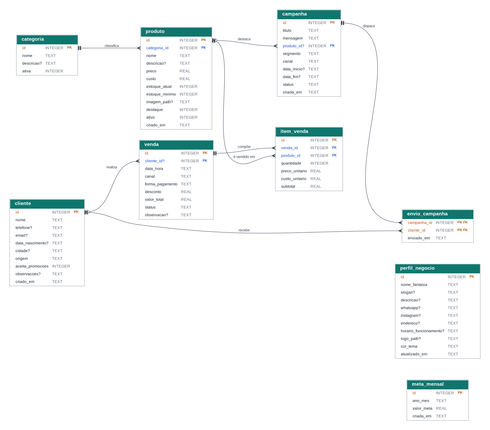
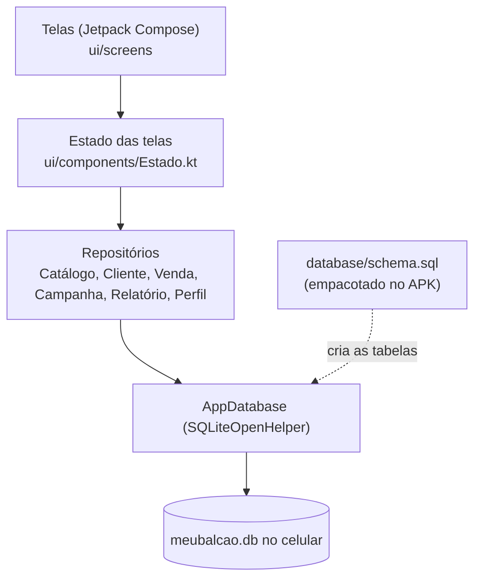

# 10. Banco de dados local: como é construído e implementado

Este capítulo detalha **como o banco de dados local do MeuBalcão é construído** dentro do aplicativo: onde fica, como as tabelas são criadas, como os dados são lidos e gravados e como tudo foi testado. Os trechos de código abaixo foram copiados do código-fonte em [`app/src/main/java/com/meubalcao/app/`](../app/src/main/java/com/meubalcao/app/).

## 10.1 Banco escolhido: SQLite

O MeuBalcão usa o **SQLite**, banco de dados relacional que **já faz parte do Android** e roda dentro do próprio aplicativo, sem servidor. O acesso é feito pela API nativa `android.database.sqlite` (classe `SQLiteOpenHelper`), sem bibliotecas externas.

| Pergunta | Resposta |
|---|---|
| Onde os dados ficam? | No celular, em um único arquivo: **`meubalcao.db`**, na pasta privada do app (`/data/data/com.meubalcao.app/databases/`) |
| Funciona sem internet? | **Sim.** O app nem declara a permissão de internet. Criação, leitura e gravação são 100% locais. |
| Os dados são mantidos ao fechar o app? | Sim. Eles só são apagados se o usuário limpar os dados do app, desinstalá-lo ou usar "Apagar todos os dados". |
| Outros aplicativos acessam o arquivo? | Não. A pasta é privada do aplicativo. |

## 10.2 Requisitos mínimos da disciplina × banco implementado

| Exigência da Etapa 2 | Exigido | MeuBalcão |
|---|---|---|
| Número de tabelas | mínimo 4 | **9 tabelas** |
| Colunas por tabela | mínimo 3 | **3 a 12 colunas** (menor: `envio_campanha`, com 3) |
| Relação entre tabelas | ao menos 1 relação entre 2 tabelas | **7 relacionamentos** com chave estrangeira (`FOREIGN KEY`) |

| Tabela | Colunas | Relaciona-se com | Para que serve |
|---|---|---|---|
| `perfil_negocio` | 11 | — | Dados do negócio e da vitrine (linha única, `id = 1`) |
| `categoria` | 4 | `produto` (1:N) | Organiza o catálogo |
| `produto` | 12 | `categoria`, `item_venda`, `campanha` | Produtos com preço, custo e estoque |
| `cliente` | 10 | `venda`, `envio_campanha` | Mini-CRM de clientes |
| `venda` | 9 | `cliente`, `item_venda` | Cabeçalho de cada venda |
| `item_venda` | 7 | `venda`, `produto` | Itens de cada venda (associativa venda × produto) |
| `campanha` | 10 | `produto`, `envio_campanha` | Campanhas promocionais |
| `envio_campanha` | 3 | `campanha`, `cliente` | Quem recebeu cada campanha (associativa) |
| `meta_mensal` | 4 | — | Meta de faturamento por mês |

O diagrama ER e o dicionário de dados completo estão em [Modelo ER](05-modelo-er.md). O script de criação está em [`database/schema.sql`](../database/schema.sql).



## 10.3 Arquitetura: as telas nunca escrevem SQL



| Camada | Arquivos | Responsabilidade |
|---|---|---|
| Banco | `data/db/AppDatabase.kt`, `data/db/SqlScript.kt` | Abre o arquivo, ativa chaves estrangeiras, cria as tabelas, transações, backup |
| Modelos | `data/model/Modelos.kt` | Classes Kotlin que espelham as tabelas (`Produto`, `Cliente`, `Venda`…) |
| Repositórios | `data/repo/*Repository.kt` | Todo o SQL do app: consultas, gravações e regras de negócio |
| Estado | `ui/components/Estado.kt` | Executa as consultas em segundo plano e recarrega as telas após cada gravação |
| Telas | `ui/screens/*.kt` | Exibem os dados e chamam os repositórios |

## 10.4 Passo 1: o script SQL é empacotado no APK

O mesmo arquivo `database/schema.sql` usado na documentação é o que cria o banco no celular. O `app/build.gradle.kts` declara a pasta `database/` como pasta de *assets* do Android:

```kotlin
// app/build.gradle.kts
android {
    // Os scripts SQL da pasta database/ (schema.sql e seed.sql) são empacotados
    // no APK como assets: o banco do app é criado exatamente pelo mesmo script.
    sourceSets["main"].assets.srcDirs("../database")
}
```

## 10.5 Passo 2: abertura e criação das tabelas

A classe `AppDatabase` estende `SQLiteOpenHelper` e é um *singleton* (uma única conexão no app inteiro):

```kotlin
// data/db/AppDatabase.kt (trechos)
class AppDatabase private constructor(private val context: Context) :
    SQLiteOpenHelper(context, NOME_ARQUIVO, null, VERSAO) {

    companion object {
        const val NOME_ARQUIVO = "meubalcao.db"
        const val VERSAO = 1
        fun get(context: Context): AppDatabase = ...   // singleton
    }

    // Executado a cada abertura: sem isto o SQLite ignora as chaves estrangeiras
    override fun onConfigure(db: SQLiteDatabase) {
        super.onConfigure(db)
        db.setForeignKeyConstraintsEnabled(true)
        db.disableWriteAheadLogging()   // arquivo único: o backup é uma cópia fiel
    }

    // Executado somente quando meubalcao.db ainda não existe (primeira abertura)
    override fun onCreate(db: SQLiteDatabase) {
        executarScript(db, "schema.sql")
    }

    // Executado quando uma nova versão do app precisa alterar um banco existente
    override fun onUpgrade(db: SQLiteDatabase, antiga: Int, nova: Int) {
        // if (antiga < 2) db.execSQL("ALTER TABLE produto ADD COLUMN codigo_barras TEXT")
    }

    /** Executa um script .sql dos assets, comando a comando, dentro de uma transação. */
    fun executarScript(db: SQLiteDatabase, asset: String) {
        val texto = context.assets.open(asset).bufferedReader(Charsets.UTF_8).use { it.readText() }
        val comandos = SqlScript.dividir(texto).filterNot { it.uppercase().startsWith("PRAGMA") }
        db.beginTransaction()
        try {
            comandos.forEach { db.execSQL(it) }
            db.setTransactionSuccessful()
        } finally {
            db.endTransaction()
        }
    }
}
```

O `SqlScript.dividir` separa o script nos `;`, ignorando comentários `--` e respeitando textos entre aspas. Assim, uma mensagem como `'Olá; tudo bem?'` não quebra o comando.

**Quando isso acontece no app:** na tela de abertura (T01), que força a abertura do banco em segundo plano:

```kotlin
// ui/screens/AberturaScreen.kt
LaunchedEffect(Unit) {
    withContext(Dispatchers.IO) {
        // Na primeira execução cria as 9 tabelas a partir do schema.sql
        Repositorios.db.writableDatabase
    }
    aoConcluir()   // segue para o Painel
}
```

## 10.6 Passo 3: tabelas e restrições criadas

O `schema.sql` cria as 9 tabelas com as restrições que garantem a integridade dos dados **no próprio banco**:

| Restrição | Exemplo no esquema | O que garante |
|---|---|---|
| `PRIMARY KEY AUTOINCREMENT` | `produto.id` | Identificador único de cada registro |
| `FOREIGN KEY … REFERENCES` | `produto.categoria_id → categoria.id` | Não existe produto em categoria inexistente |
| `ON DELETE CASCADE` | `item_venda.venda_id` | Itens acompanham a venda |
| `ON DELETE RESTRICT` | `item_venda.produto_id` | Produto vendido não pode ser apagado (só desativado) |
| `UNIQUE` | `cliente.telefone`, `meta_mensal.ano_mes` | Telefone não se repete (RN11), uma meta por mês (RN10) |
| `CHECK` | `produto.estoque_atual >= 0` | **O estoque nunca fica negativo** (RN01) |
| `CHECK (… IN (…))` | `venda.status IN ('CONCLUIDA','CANCELADA')` | Só valores válidos |
| `DEFAULT` | `venda.data_hora DEFAULT (datetime('now','localtime'))` | Data/hora preenchida automaticamente |

Trecho do esquema (relação **produto → categoria**):

```sql
CREATE TABLE categoria (
    id        INTEGER PRIMARY KEY AUTOINCREMENT,
    nome      TEXT    NOT NULL UNIQUE COLLATE NOCASE,
    descricao TEXT,
    ativa     INTEGER NOT NULL DEFAULT 1 CHECK (ativa IN (0,1))
);

CREATE TABLE produto (
    id             INTEGER PRIMARY KEY AUTOINCREMENT,
    categoria_id   INTEGER NOT NULL
                   REFERENCES categoria(id) ON UPDATE CASCADE ON DELETE RESTRICT,
    nome           TEXT    NOT NULL,
    preco          REAL    NOT NULL CHECK (preco >= 0),
    estoque_atual  INTEGER NOT NULL DEFAULT 0 CHECK (estoque_atual >= 0),
    ...
);
```

## 10.7 Passo 4: leitura e gravação pelos repositórios

### Consulta com JOIN (catálogo com o nome da categoria)

```kotlin
// data/repo/CatalogoRepository.kt
private val selectProduto =
    "SELECT p.*, c.nome AS categoria_nome FROM produto p JOIN categoria c ON c.id = p.categoria_id"

fun produtos(busca: String = "", categoriaId: Long? = null, incluirInativos: Boolean = true): List<Produto> {
    val filtros = mutableListOf("p.nome LIKE ?")
    val args = mutableListOf<Any?>("%${busca.trim()}%")
    if (categoriaId != null) { filtros += "p.categoria_id = ?"; args += categoriaId }
    if (!incluirInativos) filtros += "p.ativo = 1"
    return db.consultar("$selectProduto WHERE ${filtros.joinToString(" AND ")} ORDER BY ...",
        *args.toTypedArray(), mapear = ::mapear)
}
```

Todos os valores digitados pelo usuário entram como **parâmetros `?`**, nunca concatenados no SQL, o que evita *SQL injection*.

### Registrar uma venda (transação em 3 tabelas)

Uma venda grava em `venda`, `item_venda` e `produto`. Se qualquer passo falhar, por exemplo por estoque insuficiente, **nada é gravado** (RNF07):

```kotlin
// data/repo/VendaRepository.kt (resumido)
fun registrar(venda: Venda, itens: List<ItemVenda>): Long {
    if (itens.isEmpty()) throw RegraNegocioException("Adicione pelo menos um item à venda.")   // RN04
    return db.transacao { w ->
        // RN02: preço e custo vêm do cadastro atual do produto
        val precos = itens.associate { it.produtoId to buscarPrecoCustoEstoque(it.produtoId) }
        val soma = itens.sumOf { precos.getValue(it.produtoId).preco * it.quantidade }
        if (venda.desconto > soma) throw RegraNegocioException("O desconto não pode ser maior …")   // RN03

        val vendaId = w.insertOrThrow("venda", null, valores(
            "cliente_id" to venda.clienteId, "canal" to venda.canal.name,
            "forma_pagamento" to venda.formaPagamento.name, "desconto" to venda.desconto,
            "valor_total" to soma - venda.desconto))

        for (item in itens) {
            val p = precos.getValue(item.produtoId)
            if (item.quantidade > p.estoque) throw RegraNegocioException("Estoque insuficiente …")    // RN01
            w.insertOrThrow("item_venda", null, valores(
                "venda_id" to vendaId, "produto_id" to item.produtoId, "quantidade" to item.quantidade,
                "preco_unitario" to p.preco, "custo_unitario" to p.custo, "subtotal" to p.preco * item.quantidade))
            // Baixa automática; o CHECK (estoque_atual >= 0) do banco é a última barreira
            w.execSQL("UPDATE produto SET estoque_atual = estoque_atual - ? WHERE id = ?",
                arrayOf<Any>(item.quantidade, item.produtoId))
        }
        vendaId
    }
}
```

### Cancelar a venda (devolução ao estoque)

```kotlin
fun cancelar(vendaId: Long) = db.transacao { w ->
    val alteradas = w.compileStatement(
        "UPDATE venda SET status = 'CANCELADA' WHERE id = ? AND status = 'CONCLUIDA'"
    ).apply { bindLong(1, vendaId) }.executeUpdateDelete()
    if (alteradas == 1) {   // só devolve se a venda estava concluída
        w.execSQL("""UPDATE produto SET estoque_atual = estoque_atual +
                       (SELECT SUM(quantidade) FROM item_venda WHERE venda_id = ? AND produto_id = produto.id)
                     WHERE id IN (SELECT produto_id FROM item_venda WHERE venda_id = ?)""",
                  arrayOf(vendaId, vendaId))
    }
}
```

### Consultas analíticas (painel e relatórios)

As consultas de [`database/consultas.sql`](../database/consultas.sql) foram levadas para `RelatorioRepository.kt`, parametrizadas pelo período (hoje, 7, 30 ou 90 dias). Exemplo, o lucro bruto (RN07):

```kotlin
val custo = db.consultarUm("""
    SELECT COALESCE(SUM(iv.custo_unitario * iv.quantidade),0)
    FROM item_venda iv JOIN venda v ON v.id = iv.venda_id
    WHERE v.status = 'CONCLUIDA' AND date(v.data_hora) >= date('now','localtime','-${dias - 1} days')
""") { it.getDouble(0) }!!
return Indicadores(vendas, faturamento, ticketMedio, lucroBruto = faturamento - custo)
```

A segmentação de clientes (RN08) também é feita em SQL, com `LEFT JOIN` entre `cliente` e `venda` e `HAVING` por segmento: recorrentes (3 ou mais compras), inativos (mais de 30 dias sem comprar), novos (cadastro nos últimos 30 dias) e aniversariantes do mês.

## 10.8 Atualização automática das telas

Toda gravação feita por um repositório chama `Repositorios.notificarMudanca()`, que incrementa um `StateFlow`. As telas observam esse valor e recarregam suas consultas, sempre fora da *thread* principal:

```kotlin
// ui/components/Estado.kt
@Composable
fun <T> carregar(vararg chaves: Any?, consulta: () -> T): T? {
    val versao by Repositorios.versao.collectAsState()
    var valor by remember { mutableStateOf<T?>(null) }
    LaunchedEffect(versao, *chaves) {
        valor = withContext(Dispatchers.IO) { consulta() }
    }
    return valor
}
```

Erros de restrição do banco (`SQLiteConstraintException`, por exemplo um telefone repetido) e de regra de negócio viram mensagens amigáveis ao usuário, como "Já existe um cliente com este telefone".

## 10.9 Dados de exemplo e limpeza (RF27)

Em **Mais → Configurações** (ou no painel vazio), o botão **Carregar dados de exemplo** apaga as tabelas e executa o [`database/seed.sql`](../database/seed.sql): 1 negócio, 4 categorias, 12 produtos, 10 clientes, 101 vendas com 230 itens, 3 campanhas e a meta do mês. As datas do seed são **relativas a hoje** (`datetime('now','localtime','-10 days')`), então os gráficos sempre têm dados recentes.

## 10.10 Backup e restauração (RF26)

Como todos os dados estão em um único arquivo, o backup é uma cópia dele:

1. **Exportar:** o usuário escolhe onde salvar (Downloads, Google Drive…). O app fecha a conexão e copia `meubalcao.db` para o arquivo escolhido.
2. **Restaurar:** o usuário escolhe o arquivo. O app confere se ele começa com o cabeçalho `SQLite format 3` e se contém as tabelas do MeuBalcão. Só então substitui o banco atual e reabre a conexão. Um arquivo inválido é recusado sem alterar nada.

```kotlin
// data/db/AppDatabase.kt
fun restaurar(origem: InputStream) {
    val temp = File(context.cacheDir, "restaurar.db")
    origem.use { entrada -> temp.outputStream().use { entrada.copyTo(it) } }
    val cabecalho = temp.inputStream().use { s -> ByteArray(16).also { s.read(it) } }
    require(String(cabecalho, Charsets.US_ASCII).startsWith("SQLite format 3")) {
        "O arquivo escolhido não é um backup do MeuBalcão."
    }
    // ... confere as tabelas, fecha a conexão, substitui o arquivo e reabre
}
```

> Limitação: as fotos dos produtos e o logotipo ficam na pasta privada de imagens do app e **não** entram no backup. Apenas o caminho delas é salvo no banco.

## 10.11 Testes automatizados do banco

Os testes rodam no computador com o **SQLite real do Android**, por meio do Robolectric:

```bash
gradlew testDebugUnitTest
```

Resultado: **18 testes, 0 falhas** (`BancoDeDadosTest` com 13 e `FormatosTest` com 5).

| Teste ([`BancoDeDadosTest.kt`](../app/src/test/java/com/meubalcao/app/BancoDeDadosTest.kt)) | Regra verificada |
|---|---|
| Esquema cria as 9 tabelas com chaves estrangeiras ativas | Criação pelo `schema.sql` |
| Dados de exemplo carregam do `seed.sql` | RF27 |
| Venda baixa o estoque e copia preço e custo | RF10, RN02, RN03 |
| Estoque insuficiente desfaz toda a venda | RN01, RNF07 (*rollback*) |
| `CHECK` do banco impede estoque negativo | RN01 |
| Desconto maior que os itens e venda sem itens são recusados | RN03, RN04 |
| Cancelar devolve ao estoque e tira dos relatórios | RF11, RN05 |
| Telefone de cliente não se repete | RN11 (`UNIQUE`) |
| Chave estrangeira inexistente é bloqueada | `FOREIGN KEY` |
| Segmentos de clientes seguem as regras | RN08, RN09 |
| Consultas do painel batem com os dados | RF21 a RF24 |
| Backup e restauração preservam os dados | RF26 |
| Divisor de script respeita textos com `;` | Criação do banco |

## 10.12 Segurança e limitações

- O arquivo fica na **área privada** do aplicativo, inacessível a outros apps em aparelhos sem *root*.
- O banco não é criptografado nesta versão.
- Os dados existem **somente** no aparelho. Se o celular for perdido ou o app desinstalado, só é possível recuperar o que estiver em um backup.
- Os dados pessoais dos clientes ficam sob a guarda do próprio lojista. O campo `aceita_promocoes` registra o consentimento para campanhas, e somente esses clientes entram no público de uma campanha (RN09).
