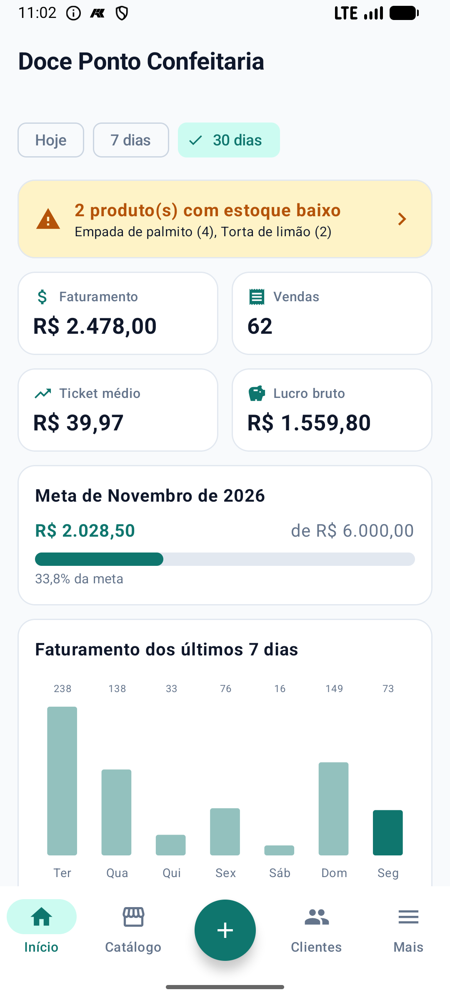
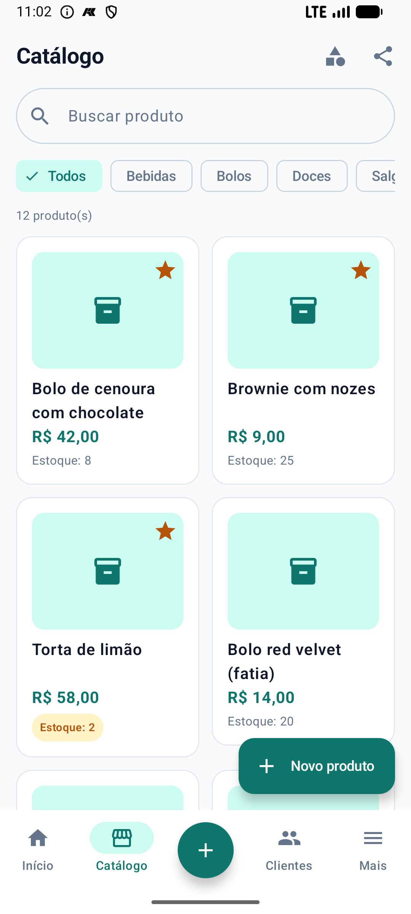
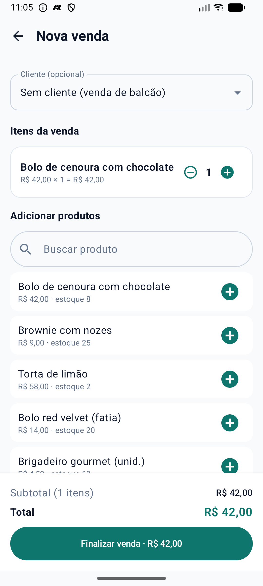
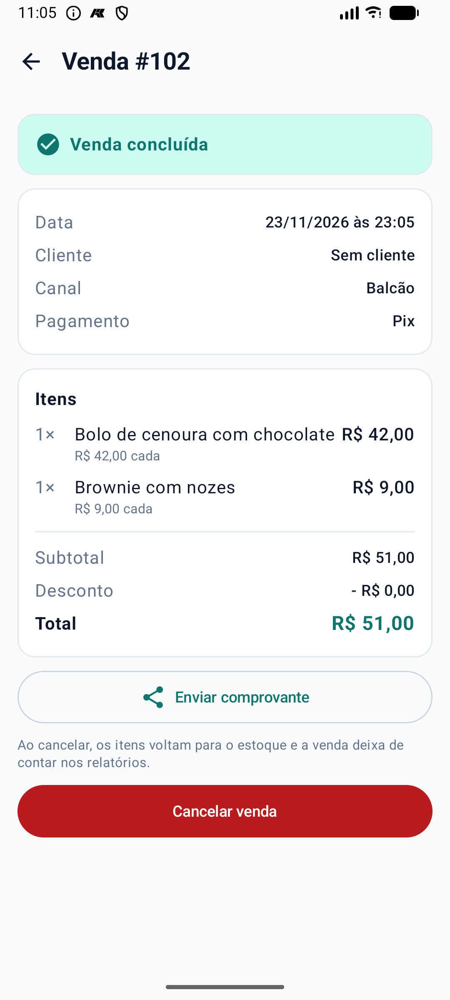
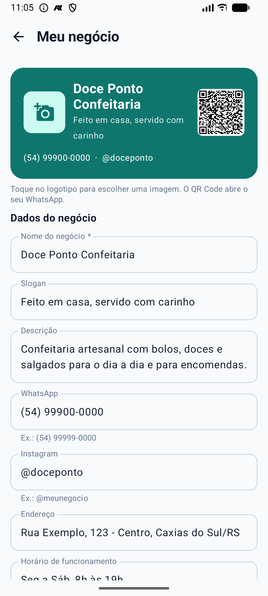
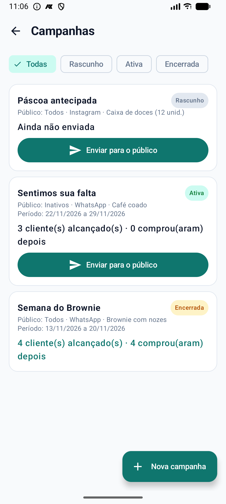
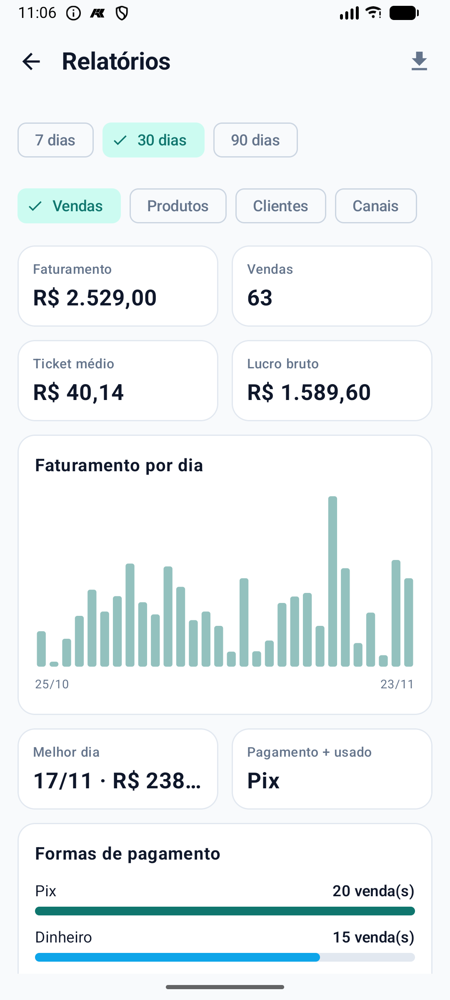
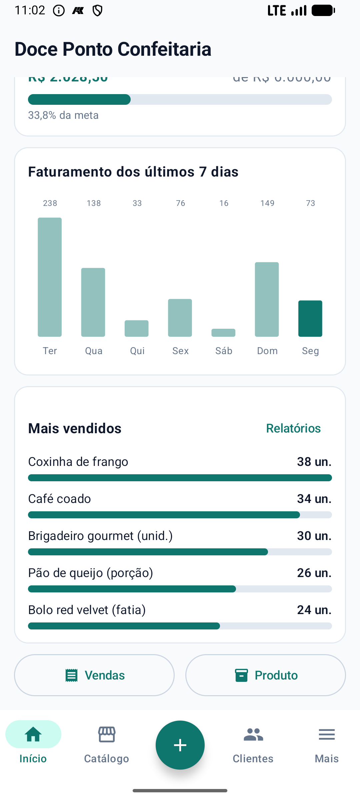
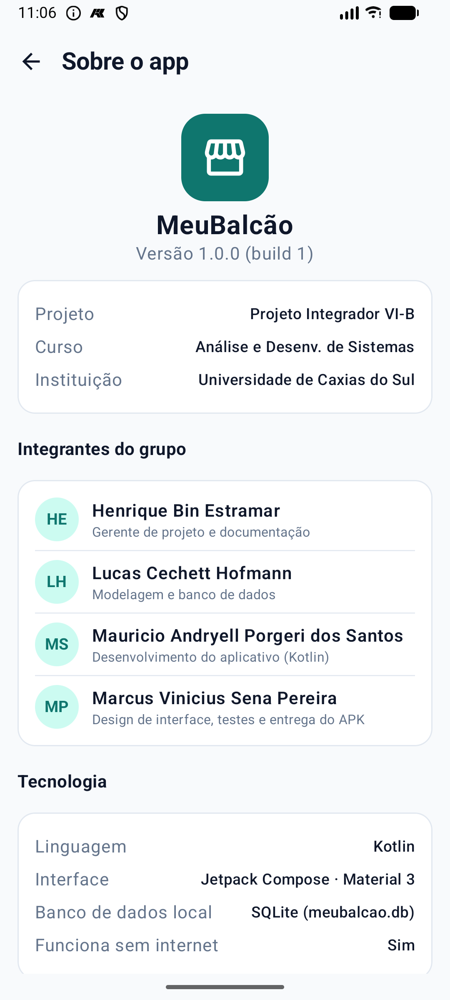

# 11. Implementação do aplicativo (Etapa 2)

Este capítulo descreve **como o aplicativo foi construído**: organização do código-fonte, etapas da construção, componentes usados e situação final de cada requisito.

## 11.1 Resumo

| Item | Situação final |
|---|---|
| Plataforma | Android 8.0 (API 26) ou superior |
| Linguagem / interface | Kotlin + Jetpack Compose (Material 3) |
| Banco de dados local | SQLite nativo, arquivo `meubalcao.db`, 9 tabelas |
| Telas | 17 telas dos wireframes + 2 telas auxiliares (cadastro de cliente, envio de campanha) + gerenciamento de categorias |
| Requisitos funcionais | 28 de 28 implementados |
| Testes automatizados | 18 testes, 0 falhas |
| APK | [`apk/MeuBalcao-1.0.0.apk`](../apk/MeuBalcao-1.0.0.apk), cerca de 1,4 MB |

## 11.2 Telas do aplicativo funcionando

| Painel (T02) | Catálogo (T03) | Nova venda (T06) |
|---|---|---|
|  |  |  |
| **Detalhe da venda (T08)** | **Meu negócio (T14)** | **Campanhas (T12)** |
|  |  |  |
| **Relatórios (T11)** | **Ranking do painel (T02)** | **Sobre e integrantes (T17)** |
|  |  |  |

## 11.3 Organização do código-fonte

```text
projeto-integrador-2026-2/
├── settings.gradle.kts, build.gradle.kts, gradle.properties   ← configuração do Gradle
├── gradlew, gradlew.bat, gradle/wrapper/                       ← Gradle Wrapper (não precisa instalar)
├── database/                                                   ← scripts SQL (empacotados no APK)
│   ├── schema.sql    seed.sql    consultas.sql
├── apk/MeuBalcao-1.0.0.apk                                     ← APK entregue
└── app/
    ├── build.gradle.kts                                        ← versão, SDKs, bibliotecas, assinatura
    └── src/
        ├── main/
        │   ├── AndroidManifest.xml
        │   ├── res/                                            ← ícone, tema, textos
        │   └── java/com/meubalcao/app/
        │       ├── MainActivity.kt                             ← ponto de entrada
        │       ├── data/
        │       │   ├── db/AppDatabase.kt                       ← abre/cria o banco, transações, backup
        │       │   ├── db/SqlScript.kt                         ← lê o schema.sql comando a comando
        │       │   ├── model/Modelos.kt                        ← classes das tabelas
        │       │   └── repo/                                   ← todo o SQL do app
        │       │       ├── Repositorios.kt                     ← acesso único + aviso de mudanças
        │       │       ├── CatalogoRepository.kt               ← categoria, produto
        │       │       ├── ClienteRepository.kt                ← cliente, segmentos
        │       │       ├── VendaRepository.kt                  ← venda, item_venda, estoque
        │       │       ├── CampanhaRepository.kt               ← campanha, envio_campanha
        │       │       ├── PerfilRepository.kt                 ← perfil_negocio, meta_mensal
        │       │       └── RelatorioRepository.kt              ← painel e relatórios
        │       ├── ui/
        │       │   ├── Navegacao.kt                            ← rotas e barra inferior
        │       │   ├── theme/Tema.kt                           ← cores e tema Material 3
        │       │   ├── components/                             ← componentes reutilizáveis
        │       │   │   ├── Componentes.kt                      ← Tela, Cartao, Campo, Filtros, Selo…
        │       │   │   ├── Graficos.kt                         ← gráficos com Canvas
        │       │   │   └── Estado.kt                           ← carregar() e gravar()
        │       │   └── screens/                                ← telas T01 a T17
        │       │       ├── AberturaScreen.kt                   ← T01
        │       │       ├── PainelScreen.kt                     ← T02
        │       │       ├── CatalogoScreens.kt                  ← T03, T04, T05, categorias
        │       │       ├── VendaScreens.kt                     ← T06, T07, T08
        │       │       ├── ClienteScreens.kt                   ← T09, T10, cadastro
        │       │       ├── RelatoriosScreen.kt                 ← T11
        │       │       ├── CampanhaScreens.kt                  ← T12, T13, envio
        │       │       ├── NegocioScreens.kt                   ← T14, T15
        │       │       └── ConfigSobreScreens.kt               ← T16, T17
        │       └── util/                                       ← formatação, WhatsApp, QR, vitrine, CSV
        └── test/java/com/meubalcao/app/                        ← testes automatizados
            ├── BancoDeDadosTest.kt
            └── FormatosTest.kt
```

A organização segue as camadas previstas no RNF08: **interface → estado → repositórios → banco**. Nenhuma tela escreve SQL.

## 11.4 Etapas da construção

1. **Configuração do projeto:** Gradle Wrapper 8.14.3, Android Gradle Plugin 8.12, Kotlin 2.1.20, Compose; `applicationId com.meubalcao.app`, `minSdk 26`.
2. **Banco de dados:** `AppDatabase` executa o `database/schema.sql` empacotado como *asset* e cria as 9 tabelas na primeira abertura ([capítulo 10](10-banco-local.md)).
3. **Modelos e repositórios:** uma classe Kotlin por tabela e um repositório por módulo, com as regras de negócio RN01 a RN11.
4. **Componentes e tema:** cores dos wireframes (`#0F766E`, âmbar para alertas, vermelho para ações destrutivas), botões com no mínimo 48 dp.
5. **Navegação:** barra inferior com Início, Catálogo, **Vender** (botão central), Clientes e Mais.
6. **Telas:** T01 a T17, na ordem dos módulos (catálogo → vendas → clientes → campanhas → relatórios → configurações).
7. **Integrações:** WhatsApp (`wa.me`), discador, compartilhamento de imagem/CSV (`FileProvider`), seletor de fotos e escolha de arquivo de backup.
8. **Testes:** 18 testes automatizados com Robolectric e teste manual no emulador Android 16 (API 36).
9. **APK:** `gradlew assembleRelease`, com o código reduzido pelo R8 ([capítulo 8](08-geracao-apk.md)).

## 11.5 Requisitos funcionais implementados

| ID | Funcionalidade | Onde está |
|---|---|---|
| RF01 | Perfil do negócio | `NegocioScreens.kt` → `MeuNegocioScreen` |
| RF02 | Vitrine digital compartilhável (imagem + texto) | `util/Vitrine.kt`, botão compartilhar no Catálogo e em Meu negócio |
| RF03 | QR Code do negócio e do produto | `util/Imagens.qrCode` (ZXing), T14 e T05 |
| RF04 | Compartilhar produto no WhatsApp | `ProdutoDetalheScreen` |
| RF05 | Categorias: criar, editar, desativar | `CategoriasScreen`, botão "Nova" no cadastro de produto |
| RF06 | Produtos com foto, preço, custo e estoque | `ProdutoFormScreen`, `ProdutoDetalheScreen` |
| RF07 | Busca e filtro por categoria | `CatalogoScreen` |
| RF08 | Destaque da vitrine | Chave "Destaque" no produto (estrela no catálogo) |
| RF09 | Alerta de estoque baixo | Cartão âmbar no Painel, selo no Catálogo |
| RF10 | Registrar venda com baixa de estoque | `NovaVendaScreen` + `VendaRepository.registrar` (transação) |
| RF11 | Cancelar venda devolvendo ao estoque | `VendaDetalheScreen` + `VendaRepository.cancelar` |
| RF12 | Histórico com filtro por situação | `HistoricoVendasScreen` |
| RF13 | Cadastro de clientes | `ClienteFormScreen` |
| RF14 | Segmentação automática | `ClienteRepository` (SQL com `HAVING`), filtros em `ClientesScreen` |
| RF15 | Histórico, total gasto e ticket médio do cliente | `ClienteDetalheScreen` |
| RF16 | Contato por WhatsApp ou ligação | Botões em `ClienteDetalheScreen` |
| RF17 | Campanhas com modelos de mensagem | `CampanhaFormScreen` |
| RF18 | Público por segmento, só quem aceita promoções | `ClienteRepository.publico` |
| RF19 | Envio personalizado pelo WhatsApp com registro | `CampanhaEnvioScreen` → `envio_campanha` |
| RF20 | Resultado da campanha | `CampanhaRepository` (alcançados × compraram depois) |
| RF21 | Painel com faturamento, vendas, ticket e lucro | `PainelScreen` |
| RF22 | Meta mensal e progresso | `ConfiguracoesScreen` + cartão no Painel |
| RF23 | Gráficos por dia e por canal | `ui/components/Graficos.kt` |
| RF24 | Rankings de produtos e clientes | Painel e Relatórios |
| RF25 | Exportar CSV | Ícone de download em `RelatoriosScreen` (`util/Csv.kt`) |
| RF26 | Backup e restauração | `ConfiguracoesScreen` + `AppDatabase.exportar/restaurar` |
| RF27 | Dados de exemplo e apagar tudo | `ConfiguracoesScreen` e painel vazio |
| RF28 | Sobre o app com os integrantes | `SobreScreen` ([capítulo 7](07-tela-integrantes.md)) |

## 11.6 Diferenças em relação ao planejamento da Etapa 1

| Planejado | Implementado | Motivo |
|---|---|---|
| Flutter / Dart | Kotlin / Jetpack Compose | Ambiente Android Studio já pronto; app nativo e APK menor (1,4 MB) |
| `sqflite` | `SQLiteOpenHelper` nativo | Mesmo SQLite, sem dependência externa |
| Backup enviado pela folha de compartilhamento | Usuário escolhe onde salvar o arquivo (`CreateDocument`) | Mais confiável para salvar em Downloads ou Drive |
| Testes com `sqflite_common_ffi` | Testes com Robolectric | Equivalente para Kotlin: SQLite real do Android no computador |
| — | Tela de gerenciamento de categorias e tela de envio de campanha | Necessárias para RF05 e RF19 |

O modelo de dados ([capítulo 5](05-modelo-er.md)), as regras de negócio e os requisitos **não mudaram**.

## 11.7 Como executar a partir do código

```bash
git clone https://github.com/Marcus-Monaco/projeto-integrador-2026-2.git
```

1. Abrir a pasta no **Android Studio** (*File → Open*).
2. Aguardar a sincronização do Gradle.
3. Iniciar um emulador no *Device Manager* e clicar em **▶ Run 'app'**.
4. No painel, tocar em **Carregar dados de exemplo** para ver o app com dados.

Ou instalar direto o APK: [`apk/MeuBalcao-1.0.0.apk`](../apk/MeuBalcao-1.0.0.apk).
